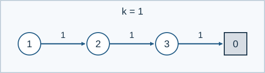

# Equivalent Rooms in a Dungeon

Indicative time limit: 0.5 seconds. Memory limit: 128 MiB. Recalibrate as twice the slowest standard median in the target environment, rounded up to 0.5 seconds. See the [environment](../../../docs/评测环境与性能.md).

## Story

An exploration robot cannot see room labels. It can issue direction commands and observe whether it hits an obstacle. It wants to group rooms that no experiment of this kind can distinguish.

(This story was rewritten by GPT-6.)

## Formal Problem Statement

A dungeon has $n$ rooms numbered $1,\ldots,n$ and direction commands numbered $1,\ldots,k$ . The transition table gives $a_{u,j}\in[0,n]$ . Issuing command $j$ from room $u$ moves to room $a_{u,j}$ when that value is positive. A zero means an obstacle is encountered and the current command sequence stops immediately.

An experiment starts in a specified room and executes any finite command sequence. Its result records only whether an obstacle was encountered. The empty sequence has result false. Two rooms are behaviorally equivalent if every finite command sequence gives the same result from both rooms. Each experiment restarts from its specified room.

Count equivalence classes among the $n$ rooms. Zero denotes an obstacle, not a room, and is excluded from the answer.



This is Sample 3. Starting from rooms 1, 2, and 3 reaches the obstacle on command 3, 2, and 1, respectively, so there are three types.

## Input Format

The first line contains `n k` . The next $n$ lines give the table: line $u$ contains $k$ integers $a_{u,1},\ldots,a_{u,k}$ .

## Output Format

Print the number of behavioral equivalence classes of rooms.

## Sample 1

### Input

```text
4 2
2 0
2 0
4 0
0 0
```

### Output

```text
3
```


## Sample 2

### Input

```text
3 1
2
3
1
```

### Output

```text
1
```


## Sample 3

### Input

```text
3 1
2
3
0
```

### Output

```text
3
```

## Constraints and Scoring

$1\le n\le200000$ , $1\le k\le26$ , $nk\le2000000$ , and $0\le a_{u,j}\le n$ .

Completed by Codex (GPT-6) and recorded as a redesign: equivalence is defined by obstacle behavior on every command sequence, with an output objective, input format, and complete bounds.

| Score | Additional constraints |
| --- | --- |
| 100% | None |

There are ten formal files worth 10% each.

See the [test recipes](tests/README.md).
