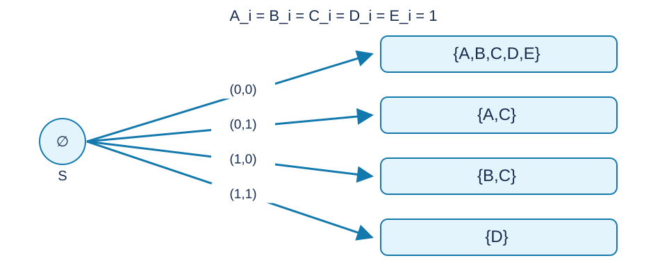

# 动态二进制约束计数：题解

## 解法与贡献

使用经典数位 DP、线段树矩阵乘法和容斥。Codex（GPT-6）给出本题的状态、可比较掩码压缩、计数反演及标准 C++17 实现。[参考程序](std.cpp)。

## 用一个状态同时处理五个上界

从高位到低位枚举 $a,b$ 的二进制位，每列只有四种位对。相应的五个比较位是
$$
(a_i,b_i,a_i\&b_i,a_i\oplus b_i,a_i|b_i).
$$
用五位集合 $S$ 表示已经严格小于上界、或者主动忽略的比较。集合中没有的比较仍处于前缀相等状态。

对于相等状态，当前值大于上界位则转移非法；小于则把对应比较加入 $S$ ；等于则保留状态。已经加入的比较以后不再限制当前位。所有转移只会增大集合，不会移除元素。

下图以五个当前上界位均为一、开始集合为空为例。四种位对分别得到图中的松弛集合；字母表示对应哪个上界已经严格小于。

该状态正确的原因是二进制整数比较由首个不同位决定。对已经严格更小的前缀，后缀任意；前缀一直相等到末尾也满足不大于关系。又因为 $a\le A,b\le B$ ，无需枚举超过 $n$ 位的数。

## 压缩矩阵乘法

一列对应转移矩阵 $M[S,T]$ ，值为从状态 $S$ 变成 $T$ 的位对数量。只可能有 $S\subseteq T$ .每个比较在一对可比较集合中只有三种状态：都没有、后者才有、两者都有。因此有效元素数为 $3^c$ ，其中比较数 $c=5$ .

合并相邻区间时，
$$
(LR)[S,T]=\sum_{S\subseteq U\subseteq T}L[S,U]R[U,T].
$$
每个比较在三集合链中有四种状态，所以一轮乘法共需 $4^c$ 个乘积。程序预先建立元素编号与乘积索引；本题分别为二百四十三个元素和一千零二十四个乘积。

线段树按从高位到低位维护矩阵积，左右顺序不能交换。补到二次幂的叶子使用单位矩阵。修改从右数第 $y$ 位，对应从左零起算的位置 $n-y$ ，只需重建一个叶子并更新祖先。每八个乘积进行一次取模，避免三十二项相加溢出无符号六十四位整数。

## 从“至少指定条件”得到“恰好几个条件”

对三个额外条件的任意子集 $K$ ，记 $F(K)$ 为满足 $A,B$ 的限制且满足 $K$ 中全部条件的数对数目，其余条件可以满足也可以不满足。

将未要求的额外比较在起始时直接标为松弛，基础比较 $A,B$ 保持相等。取根矩阵对应起始状态一行的总和，就得到 $F(K)$ .被忽略的比较以后不再限制任何位，含义正好一致。

令
$$
E_j=\sum_{|K|=j}F(K).
$$
若某数对恰好满足 $t$ 个额外条件，它在 $E_j$ 中恰好出现 $\binom tj$ 次。设所求四类数目为 $q_0,q_1,q_2,q_3$ ，从这个三角关系反解：
$$
\begin{aligned}
q_3&=E_3,\\
q_2&=E_2-3E_3,\\
q_1&=E_1-2E_2+3E_3,\\
q_0&=E_0-E_1+E_2-E_3.
\end{aligned}
$$
所有运算模 $998244353$ ，减法后正规化到零至模数减一。各列选择对应唯一的整数数对，转移不会重计或漏计；反演再把每个数对放到唯一的类别，所以输出正确。

## 复杂度

建树时间为 $O(4^c n)$ ，每次更新为 $O(4^c\log n)$ ，提取答案为 $O(3^c)$ 的上界；总时间为 $O(4^c(n+m\log n))$ ，空间为 $O(3^c n)$ .这里 $c$ 是比较个数，固定为五，不是二进制串的位数 $n$ .只存可比较元素使程序满足一百二十八 MB 内存限制。空修改序列仍需输出初始答案。

## 数据与复现

三个样例见题面。[生成配方](tests/plan.json)包含十份计分输入；[生成器](tests/generate.py)只依赖 Python 标准库，支持 --plan、--out-dir、--case 和 --std。正式大输入及可执行文件不放入发布包。时间和内存的参考测量见[性能记录](../../../docs/benchmark-R28.json)。
