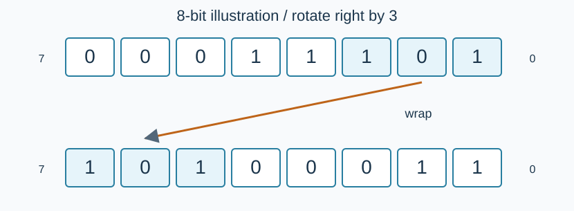

# 异星工厂：信号网络

预估时间限制：0.5 秒。内存限制：128 MB。

实际时限以标准程序在目标评测环境的最慢用例中位时间乘以 $2$ ，按 $0.5$ 秒向上取整。参考环境见[评测说明](../../../docs/评测环境与性能.md)。

## 背景故事

工厂用信号网络管理供电设备。为避免电量在阈值附近变化时反复启停，工程师尝试组合不同的二进制信号，并把循环移位、局部取反和读出操作封装成可复用设备。你需要模拟其中的信号寄存器。

## 形式化问题描述

维护一个初始为零的 $128$ 位无符号二进制数 $A$ .从最低位到最高位编号为 $0,1,\ldots,127$ ，第 $i$ 位的权值为 $2^i$ .

| 操作 | 含义 |
| --- | --- |
| `1 x` | 将整个寄存器循环右移 $x$ 位。负数表示循环左移其绝对值。 |
| `2` | 输出当前最低 $16$ 位表示的非负整数，以大写十六进制表示。 |
| `3 l r` | 将编号在闭区间 $[l,r]$ 中的每一位取反。 |

循环移位不会丢失移出端点的位，它们会从另一端补入。令 $k$ 为 $x$ 对 $128$ 取非负余数，则新第 $i$ 位等于旧第 $(i+k)\bmod128$ 位。$k=0$ 时不变。



图示用 $8$ 位寄存器演示循环右移 $3$ 位：`00011101` 变为 `10100011` .本题实际始终使用 $128$ 位。

## 输入格式

第一行一个整数 $N$ ，表示操作数。接下来 $N$ 行，每行按上表给出一个操作。

## 输出格式

对每个 `2` 操作输出一行十六进制数，使用数字 `0` 到 `9` 和大写字母 `A` 到 `F` ，不带 `0x` 前缀，不输出多余的前导零。数值为零时输出 `0` .其余操作不输出内容。

## 样例

### 样例 1

### 输入

```text
12
2
3 0 3
2
1 1
2
1 -1
2
3 0 0
2
1 128
2
2
```

### 输出

```text
0
F
7
F
E
E
E
```

### 样例 2

### 输入

```text
8
3 0 127
2
3 63 64
1 64
2
1 0
3 0 15
2
```

### 输出

```text
FFFF
FFFE
1
```

### 样例 3

### 输入

```text
0
```

### 输出

```text

```

## 样例解释

样例 1 先将最低四位设为一，得到 `F` ；右移一位后最低十六位为 `7` ，同时一位移到了最高位。反向旋转恢复原状态。样例 2 覆盖第 $63$ 位与第 $64$ 位之间的边界。样例 3 没有操作。

## 数据范围与保证

对 100% 的数据：$0\le N\le2\times10^6$ ，$|x|\le10^9$ ，$0\le l\le r\le127$ .

| 分值比例 | 额外条件 |
| --- | --- |
| 100% | 无额外条件 |
