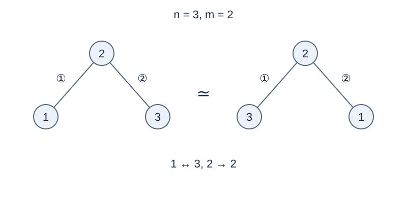

# 叶子不区分的建树顺序

## 背景故事

园区保留中转站的编号，但末端站点使用相同的牌子。统计通道施工记录时，可以统一重命名末端站点；通道出现的先后次序仍然重要。

(本故事由GPT-6重写)

## 形式化问题描述

从 $n$ 个带临时标号 $1,\ldots,n$ 的顶点开始，依次添加连接两个不同顶点的无向边，同一对顶点最多一条。最终必须是一棵树，且恰有 $m$ 个度数不超过 $1$ 的叶子。

按下面的**完整等价规则**合并记录：两条加边序列等价，当且仅当它们的非叶子标号集合相同，并且存在该叶子集合内部的一次统一重命名，使两条序列在每一步添加的无向边都相同。非叶子的名字不能变，边的顺序不能变。不同非叶子标号集合始终算不同方案。

求等价类数量模 $998244353$ 的非负最小剩余。也可以理解为先从 $1,\ldots,n$ 中选出非叶子的标号，其余叶子的名字不再区分。

约定 $n=0$ 时唯一空序列的叶子数为 $0$ ；$n=1$ 时唯一顶点是叶子。$n=2,m=2$ 时唯一的一条无向边算一种方案。

## 输入格式

一行两个非负整数 `n m` .

## 输出格式

输出一行等价类数量模 $998244353$ 的结果。

## 样例 1

### 输入

```text
3 2
```

### 输出

```text
3
```

## 样例 2

### 输入

```text
4 2
```

### 输出

```text
36
```

## 样例 3

### 输入

```text
2 2
```

### 输出

```text
1
```

## 样例 4

### 输入

```text
0 0
```

### 输出

```text
1
```

## 样例说明

三个点时可以选择 3 种中心标号；固定中心后，交换两片叶子的名字可把两种加边顺序互相变换，所以答案是 3。四点两叶时，72 条带标号记录两两等价，得到 36。两点的一条边交换端点后仍是自身，所以不能把这个边界答案再除以 2。



固定中心 2，交换叶子 1、3 的名字使两条记录等价。

## 数据范围与分组

$0\le n,m\le10^5$ .不保证 $m\le n$ ；没有方案时输出零。

规格由 Codex（GPT-6）重新设计：补齐叶子重命名的等价关系，明确保留非叶子标签、边序和小规模边界。

| 分值 | 额外条件 |
| --- | --- |
| 20% | $n\le8$ |
| 30% | $n\le1000$ |
| 50% | 无额外条件 |

## 资源限制

时间 0.5 秒；内存 128 MiB。时限为标准程序每例五次测量的最慢中位数乘以 2，向上取整到 0.5 秒。

[题解](solution.zh.md) · [测量环境](../../../docs/评测环境与性能.md) · [测量记录](../../../docs/benchmark-R33.json)
