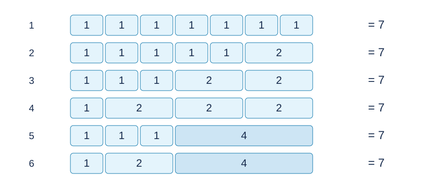

# 二的幂拆分计数：题解

**出题人解法：按二的幂分块的三维动态规划。GPT-6 补充唯一分割证明，并用后缀和减少递推枚举。**

## 1. 一块的状态

设 $C_{i,j,k}$ 表示将 $2^j$ 拆成非降的二的幂序列，最小指数恰为 $i$ 、最大指数恰为 $k$ 的方案数。必有 $0\le i\le k\le j$ .

不拆分时只有 $C_{j,j,j}=1$ .其余方案中每项至多为 $2^{j-1}$ ，可以唯一地切成和各为 $2^{j-1}$ 的左右两段。

为什么不会跳过这个切点？设下一项为 $v$ .它后方的所有项都是 $v$ 的整数倍，而总和也是 $v$ 的整数倍，所以此前前缀和也是 $v$ 的整数倍。目标 $2^{j-1}$ 同样是 $v$ 的整数倍，一步加 $v$ 不会跨过目标。所有项均为正，切点也唯一。

若左段最大指数为 $l$ 、右段最小指数为 $r$ ，跨段非降要求 $l\le r$ .于是对于 $k<j$ ，
$$
C_{i,j,k}=\sum_{l=i}^{k}\sum_{r=l}^{k}
C_{i,j-1,l}C_{r,j-1,k}.
$$
左右段的最小、最大指数决定状态，唯一切分确保没有重复或遗漏。

直接实现出题人递推需要 $O(L^5)$ 时间、$O(L^3)$ 空间，$L$ 为二进制位数。

## 2. 后缀和加速

固定 $j,k$ ，计算
$$
B_{l,k}=\sum_{r=l}^{k}C_{r,j-1,k}.
$$
从 $l=k$ 向零递推这些后缀和，再计算
$$
C_{i,j,k}=\sum_{l=i}^{k}C_{i,j-1,l}B_{l,k}.
$$
这样去掉最内层枚举，总时间降至 $O(L^4)$ ，空间保持 $O(L^3)$ .状态及计数模型完全相同；参考程序采用这一形式。

## 3. 拼接一般整数

将 $N$ 的置位下标按升序记为 $b_0<\cdots<b_{t-1}$ .一个合法非降序列可以唯一切成和为 $2^{b_0},\ldots,2^{b_{t-1}}$ 的连续块。

先考虑最小置位对应的 $T=2^{b_0}$ .若前缀尚未到达 $T$ 而下一项 $v>T$ ，剩余项都是 $v$ 的倍数，前缀和等于 $N\bmod v$ ；由于 $T$ 是最低置位，这个余数至少为 $T$ ，矛盾。故到达切点前的下一项均不超过 $T$ ，再由上一节的整除论证可知不能跨过 $T$ .移去第一块，重复论证即可。

令 $G_p(x)$ 为从第 $p$ 块开始，所有项的指数至少为 $x$ 的拼接方案数。空后缀满足 $G_t(x)=1$ .对 $b=b_p$ ，
$$
G_p(x)=\sum_{i=x}^{b}\sum_{k=i}^{b}C_{i,b,k}G_{p+1}(k).
$$
后续块的最小指数至少为当前最大指数 $k$ ，恰好保持整条序列非降。先计算固定最小指数 $i$ 的内层和，再对 $i$ 求后缀和，全部拼接需要 $O(L^3)$ 时间。答案是 $G_0(0)$ .

## 4. 边界与复杂度

$N=0$ 直接输出一。其他输入最多有 $63$ 个二进制位，仅访问指数 $0,\ldots,62$ ，不做超出类型位宽的移位。

所有递推均只用加法、乘法和取模，不需要模数为素数。模后两个数的乘积再加一个模内累加值小于 $10^{18}$ ，有符号 64 位整数足够。

总时间为 $O(L^4)$ ，空间为 $O(L^3)$ .普通完全背包需要与 $N$ 成正比的状态，只适合作为小规模核验，不能处理完整范围。

[参考程序](std.cpp)。

## 图示

下图逐行列出 $N=7$ 的六种非降拆分。每个矩形的数字和宽度对应一个二的幂，左侧数字仅为方案序号。

## 数据与复现

三个样例见题面。[生成配方](tests/plan.json)包含十份计分输入；[生成器](tests/generate.py)只依赖 Python 标准库，支持 --plan、--out-dir、--case 和 --std。正式大输入及可执行文件不放入发布包。时间和内存的参考测量见[性能记录](../../../docs/benchmark-R29.json)。
