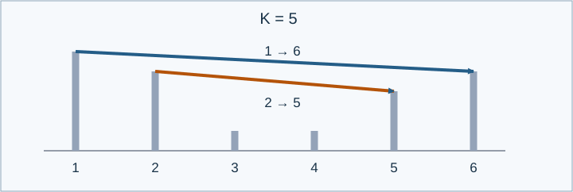

# 有限跨度的管道：题解

## 算法与贡献

Codex（GPT-6）补全几何约定，证明可实现结构与层叠匹配等价，并实现短区间动态规划。参考程序：[std.cpp](std.cpp)。

## 几何条件等价于区间不交错

每根管道占用两个塔，因而端点构成匹配。设有交错端点 $u<a<v<b$ . 管道 $(u,v)$ 在塔 $a$ 处必须严格高于其顶端；管道 $(a,b)$ 在塔 $v$ 处也必须严格高于其顶端。因此两线段在 $[a,v]$ 内的上下关系交换，必然相交。合法区间只能互相分离或包含。

反过来，任意跨度不超过 $K$ 的这种匹配，以及每根管道的任意方向，都能实现。把最外层深度设为1。深度为 $d$ 的管道将较高端点设为 $K-d+1$ ，较低端点设为 $K-d$ ，按所选方向安放。内层最高端点不超过外层最低端点，外层线段在严格内部又严格高于自己的最低端点，所以不会相交或接触塔顶。未使用的塔取高度1。

深度为 $d$ 至少需要 $2d$ 个不同端点，而最外层最多跨越 $K$ 个单位，故 $d\le\lfloor(K+1)/2\rfloor$ . 有合法必选管道时必有 $K\ge2$ ，因此所有高度均落在 $[1,K]$ .

于是只需统计这样的有向匹配。高度方案本身不计数。

## 区间递推

令 $W(j,r)$ 表示将 $j,r$ 配对的方向数：若两点是同一条必选管道的端点，为1或2；若两点都自由，为2；其余情况为0。

令 $D(l,r)$ 为区间内全部匹配的方案数。必选端点的搭档若在区间外，该区间自然无法形成完整方案。空区间值为1。按最右端点分类：

$$
D(l,r)=[r\text{ is free}]D(l,r-1)
+\sum_{j=l}^{r-1}W(j,r)D(l,j-1)D(j+1,r-1).
$$

只预处理长度小于 $K$ 的区间。设 $F(r)$ 为前 $r$ 个塔的答案，则

$$
F(r)=[r\text{ is free}]F(r-1)
+\sum_{j=\max(1,r-K)}^{r-1}W(j,r)F(j-1)D(j+1,r-1).
$$

所需内部区间的长度至多为 $K-1$ ，所以短表足够。

## 正确性

几何证明建立了合法布局与不交错匹配的对应。右端点要么自由且不使用，要么与唯一的 $j$ 配对。配对后区间左侧与内部独立，且不能有边横跨该管道边界。递推中的分类互斥、穷尽，乘上方向数后也不会重复计数。由区间长度和前缀长度归纳，输出 $F(n)$ 正确。

## 实现与复杂度

按照右端点递增计算短区间与前缀。短表只保留最近 $K+1$ 个右端点，代码用20行循环数组。时间 $O(nK^2)$ ，空间 $O(n+K^2)$ . 所有运算模998244353；乘法先升为64位，因 $2(998244353-1)^2<2^{63}$ ，不会溢出。

数据包含直接枚举小匹配、全部固定端点、长自由后缀及互相隔离的包围区间。[生成与验证说明](tests/README.md)。
