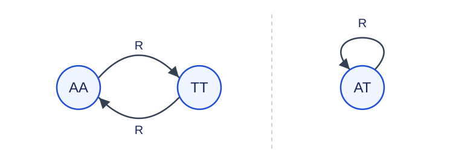

# Paired DNA Strands with Many Pair Types

Estimated time limit: 0.5 seconds. Memory limit: 128 MB.

The actual time limit is twice the slowest-case median runtime of the reference solution on the target judge, rounded up to a multiple of $0.5$ seconds. See the [benchmark environment](../../../docs/评测环境与性能.md).

## Story

Extend the model of double-stranded, non-circular DNA to an alphabet with many complementary letter pairs. Each query may use a different length, number of pair types, and modulus.

## Formal Problem Statement

A query gives $N,K,P$ . The alphabet has $K$ pairs of distinct letters $a_1,b_1,\ldots,a_K,b_K$ , for $2K$ letters in total. Letter $a_i$ complements $b_i$ . Letters from different pairs do not complement each other, and no letter complements itself.

A double-stranded structure with $N$ letter pairs is represented by a string $s$ of length $N$ . Reverse complementation is

$$R(s)=\overline{s_N}\,\overline{s_{N-1}}\cdots\overline{s_1}$$

Two strings describe the same structure exactly when they are equal or one is the reverse complement of the other. Letter types have fixed labels; renaming different complementary pairs does not create additional identifications.

Find the least nonnegative residue of the number of structures modulo $P$ . There are $M$ queries; output the bitwise XOR of all their residues.

## Input Format

The first line contains $M$ . Each of the next $M$ lines contains $N,K,P$ . The letters themselves are not input; their pairing is defined above.

## Output Format

Print one nonnegative integer: reduce each query count modulo its own $P$ , then XOR all results.

## Samples

### Sample 1

### Input

```text
3
1 1 100
2 1 100
3 2 100
```

### Output

```text
34
```

### Sample 2

### Input

```text
4
2 2 2
4 1 4
4 2 1
1 5 7
```

### Output

```text
7
```

### Sample 3

### Input

```text
1
2 3 6
```

### Output

```text
3
```

## Sample Explanation

The three counts in the first sample are $1,3,32$ , each below its modulus, and their XOR is $34$ . The second sample gives residues $0,2,0,5$ , whose XOR is seven. A modulus of one always gives residue zero.

The third sample has six letters and length two. There are $21$ structure types, giving residue three modulo six.



Here `A` , `T` denote any complementary pair. Arrows apply reverse complementation; each diagram is one equivalence class.

## Constraints and Guarantees

For all inputs, $1\le M\le500000$ and $1\le N,K,P\le10^9$ . Modulus $P$ may be one, even, or composite. Queries may repeat.

| Score share | Additional conditions |
| --- | --- |
| 100% | None |
