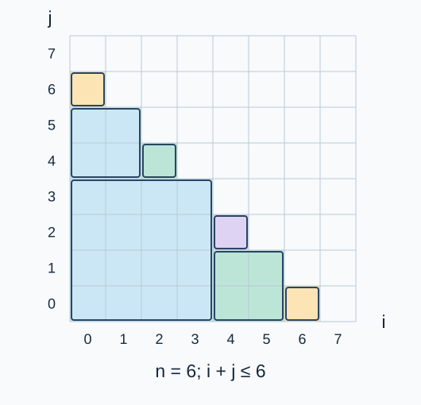

# Grox的序列四题解

**出题人解法：对齐方块分解与分阶段 FWT。** Codex（GPT-6）整理实现、零下标边界和模数运算；逐种处理三类变换并以 32 位整数保存余数。乘法仍使用 64 位整数。

## 对齐方块分解

令 $L$ 为不小于 $n+1$ 的最小二次幂，$B=\log_2L$ .把两个输入补零到长度 $L$ .所有有贡献的有序数对位于三角区域 $i+j\le n$ .

从 $[0,L-1]\times[0,L-1]$ 开始，处理一个边长为 $s=2^d$ 、左下角为 $(a,b)$ 的对齐方块。若 $a+b>n$ ，整块无贡献；若 $a+b+2s-2\le n$ ，整块计入；否则分成四个等大的子块。单点块必然属于前两种情况，不继续划分。

接受的方块互不重叠，恰好覆盖全部合法数对。在一个方块中，$a,b$ 的低 $d$ 位都为零。因此对任意一种按位运算 $\circ$ ，有

$$ (a+u)\circ(b+v)=(a\circ b)+(u\circ v)\qquad(0\le u,v<s)$$

对方块内两段数组做相应的按位卷积，结果放在偏移 $a\circ b$ 处。三种运算的结果相加，再按下标模 $3$ 分类即可。

图中每个格子代表一个有序数对。相同轮廓内的格子组成一个接受的方块，阴影外的数对不计入。

## 分阶段 FWT

长度 $2^d$ 的变换由 $d$ 层蝶形组成。一次执行第 $d$ 层，可以把全局数组中所有长度 $2^{d-1}$ 的局部变换推进到长度 $2^d$ .因而不需要为每个方块重复计算完整变换。

按 $d$ 从小到大处理。输入数组在第 $d$ 阶段恰好保存每个长度 $2^d$ 对齐区间的变换值。对所有这一层的接受方块，在频域逐项乘积，按高位偏移累加到数组 $R_d$ .

按 $d$ 从大到小处理结果：对 $R_d$ 撤销一层蝶形，再将它加到 $R_{d-1}$ .此时两者都处于低 $d-1$ 位的变换域，所以能够相加。最终 $R_0$ 是普通下标下的卷积总和。

三种变换对二元组 $(x,y)$ 的规则如下：

| 运算 | 正变换 | 逆变换 |
| --- | --- | --- |
| XOR | $(x+y,x-y)$ | $((x+y)/2,(x-y)/2)$ |
| OR | $(x,x+y)$ | $(x,y-x)$ |
| AND | $(x+y,y)$ | $(x-y,y)$ |

所有运算对 $P=1004535809$ 取模；除以 $2$ 使用 $(P+1)/2$ .按位卷积的变换性质可逐位验证：一位的四种输入配对在变换后变成逐项乘积，多个二进制位用这些二元变换的张量积处理。

## 正确性

分解对区域内每个数对只计一次。方块内，高位与低位独立，局部按位卷积恰好计算该方块的贡献。分阶段输入变换与独立变换相同；从大到小的逆变换与累加保持每层对应的变换域，最终恢复全部贡献。又因 $i\circ j\le i+j\le n$ ，所有非零贡献均落在输出涉及的下标范围内。按余数类别累加得到三个所求结果。

## 复杂度与并列方案

边长为 $s$ 的层至多包含 $O(L/s)$ 个沿边界分出的方块，所以方块逐项乘积每层共 $O(L)$ 次；全局蝶形每层也为 $O(L)$ 次。标程时间为 $O(L(1+B))$ ，空间为 $O(L(1+B))$ .$n=0$ 时 $L=1,B=0$ ，三种运算均贡献到零下标。

出题人的**逐块 FWT** 方案为每个接受方块单独做完整正逆变换，时间为 $O(L(1+B)^2)$ ，空间为 $O(L)$ .它有明确的空间优势，与分阶段方案并列介绍。`std.cpp` 选择时间阶更低的分阶段方案；[逐块方案完整题解](solution-alternative.zh.md)与 `alternative.cpp` 提供空间优先的选择。是否满足当前参考时限，见该题解中的同输入测量。

## 补充解法

余数值张量变换直接在三个余数类别中累加，时间同为 $O(L(1+B))$ ，空间降为 $O(L)$ .它以三个分量的工作值换取省去跨层卷积结果，作为并列方案保留；实际运行常数与两种 FWT 不同。

[完整题解与测量](solution-alternative-residue.zh.md) · [计算程序](alternative-residue.cpp)
