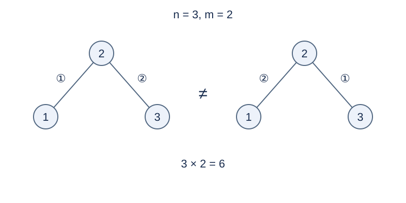

# Ordered Tree Construction with a Given Leaf Count

## Story

A park builds passages one at a time between numbered stations. The completed network must be a tree with a specified number of terminal stations. Count the different construction records.

(This story was rewritten by GPT-6.)

## Formal Problem Statement

There are $n$ vertices labeled $1,\ldots,n$ , initially without edges. Add undirected edges between distinct vertices, with at most one edge per pair. The final graph must be a tree with exactly $m$ vertices of degree at most $1$ , called leaves.

Different final edges or different insertion orders of the same edges count as different plans. Every vertex, including every leaf, has a distinct label. Print the count modulo $998244353$ as a nonnegative residue.

For $n=0$ , the empty sequence is the only plan and has $0$ leaves. For $n=1$ , the sole vertex is a leaf.

## Input Format

One line containing nonnegative integers `n m` .

## Output Format

Print the number of plans modulo $998244353$ on one line.

## Sample 1

### Input

```text
3 2
```

### Output

```text
6
```

## Sample 2

### Input

```text
4 2
```

### Output

```text
72
```

## Sample 3

### Input

```text
4 3
```

### Output

```text
24
```

## Sample 4

### Input

```text
1 0
```

### Output

```text
0
```

## Sample Explanation

For three vertices, three trees each allow two edge orders, giving 6. Four-vertex trees with two leaves are paths: 12 trees and six orders each give 72. Three leaves require a star: four stars give 24 orders. A singleton cannot have zero leaves.



A different center label or edge insertion order gives a different record.

## Constraints and Scoring

$0\le n,m\le10^5$ . It is not guaranteed that $m\le n$ ; print zero if no plan exists.

Specifications redesigned by Codex (GPT-6): the empty case, singleton leaves, and counting by labels and insertion order.

| Score | Additional constraints |
| --- | --- |
| 20% | $n\le8$ |
| 30% | $n\le1000$ |
| 50% | No additional constraints |

## Resource Limits

Time: 0.5 seconds. Memory: 128 MiB. The limit is twice the slowest standard-program median over five runs per input, rounded up to 0.5 seconds.

[Solution](solution.en.md) · [Measurement environment](../../../docs/评测环境与性能.md) · [Measurements](../../../docs/benchmark-R33.json)
