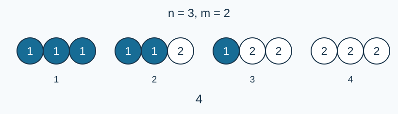

# 某不科学的单调序列计数

- 参考时间限制：0.5 秒（参考环境：R30；仅供预估）
- 实际时间限制：标准程序在目标评测环境中处理最慢正式测试文件的基准时间乘以 2，再按 0.5 秒向上取整。
- 内存限制：128 MB

## 背景故事

小A在做学园都市第零次高中模拟考试试卷时，发现了一道有意思的数学题，于是他决定结合算法知识进行数据范围加强。

## 形式化问题描述

给定正整数 $n,m$ ，求满足 $1\le x_1\le x_2\le\cdots\le x_n\le m$ 的整数序列数量，对 $p=998244353$ 取模。两个序列不同，当且仅当至少一个位置的值不同。

## 输入格式

一行两个整数 $n,m$ .

## 输出格式

一行一个整数，表示序列数量对 $p$ 取模的结果。

## 样例 1

### 输入

```text
3 2
```

### 输出

```text
4
```

### 解释

四个序列为 $(1,1,1),(1,1,2),(1,2,2),(2,2,2)$ .



每组三个圆圈表示一个序列，圈内数字是编号。

## 样例 2

### 输入

```text
1 5
```

### 输出

```text
5
```

### 解释

唯一元素可取任意可用编号。

## 样例 3

### 输入

```text
5 1
```

### 输出

```text
1
```

### 解释

每个位置只能填写一。

## 数据范围与保证

$1\le n,m\le2000$ .所有输入均为整数。

### 数据分组

| 分值比例 | 额外条件 |
| --- | --- |
| 20% | $n,m\le10$ |
| 30% | $\min(n,m)\le50$ |
| 50% | 无额外条件 |

[参考评测环境与测量](../../../docs/评测环境与性能.md)
