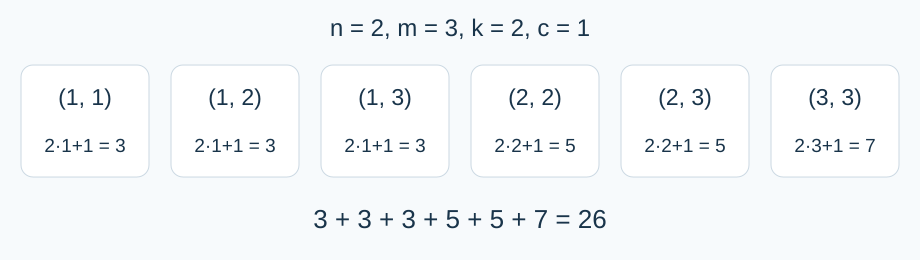

# 某不科学的单调序列的首项加权和

- 参考时间限制：0.5 秒（参考环境：R30；仅供预估）
- 实际时间限制：标准程序在目标评测环境中处理最慢正式测试文件的基准时间乘以 2，再按 0.5 秒向上取整。
- 内存限制：128 MB

## 背景故事

小A在做学园都市第零次高中模拟考试试卷时，发现了一道有意思的数学题，于是他决定结合算法知识进行数据范围加强。

## 形式化问题描述

给定整数 $n,m,k,c$ .对每个满足 $1\le x_1\le x_2\le\cdots\le x_n\le m$ 的整数序列，计入权值 $kx_1+c$ .求所有序列的权值之和，对 $p=998244353$ 取模。

$$\sum_{x_n=1}^{m}\sum_{x_{n-1}=1}^{x_n}\cdots\sum_{x_1=1}^{x_2}(kx_1+c)\pmod p$$

当 $n=1$ 时仅有一层求和；当 $m=0$ 时没有合法序列，答案为零。

## 输入格式

一行四个整数 $n,m,k,c$ ，依次表示长度、编号上界、首项系数与常数项。

## 输出格式

一行一个整数，表示答案在 $[0,p-1]$ 中的余数。

## 样例 1

### 输入

```text
2 3 2 1
```

### 输出

```text
26
```

### 解释

六个序列的权值依次为 $3,3,3,5,5,7$ ，总和为 $26$ .



六个合法序列及其权值。

## 样例 2

### 输入

```text
1 0 9 4
```

### 输出

```text
0
```

### 解释

没有合法序列。

## 样例 3

### 输入

```text
1 998244353 0 1
```

### 输出

```text
0
```

### 解释

共有 $998244353$ 个长度为一的序列，每个权值为一。

## 数据范围与保证

$1\le n\le10^7$ ；$0\le m,k,c\le10^9$ .所有输入均为整数。

### 数据分组

| 分值比例 | 额外条件 |
| --- | --- |
| 20% | $n,m\le12$ |
| 30% | $m\le2000$ |
| 50% | 无额外条件 |

[参考评测环境与测量](../../../docs/评测环境与性能.md)
