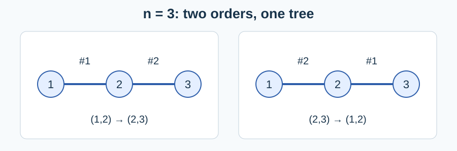

# Building a Tree in Order

Estimated time limit: 0.5 seconds. Memory limit: 128 MB.

The limit is twice the slowest median runtime of the reference program, rounded up to a multiple of $0.5$ seconds. See the [evaluation environment](../../../docs/评测环境与性能.md).

## Story

A gallery has a number of labelled exhibition areas. A crew adds two-way passages one at a time so that eventually there is exactly one simple route between every pair of areas. Count the possible construction orders.

(This story was rewritten by GPT-6.)

## Formal Problem Statement

Start with $n$ distinct vertices and no edges. Each step adds an undirected edge between two different vertices. At most one edge may join any pair. In the final graph, exactly one simple path must connect every pair of different vertices.

Count the valid edge-addition sequences modulo $998244353$ . Different final edge sets or different orders of adding the edges are distinct. For $n=0$ or $n=1$ , the unique empty sequence of operations is valid.

## Input Format

One line contains a nonnegative integer $n$ .

## Output Format

Print the least nonnegative residue of the answer.

## Samples

### Sample 1

### Input

```text
0
```

### Output

```text
1
```

### Sample 2

### Input

```text
3
```

### Output

```text
6
```

### Sample 3

### Input

```text
104
```

### Output

```text
68933342
```

## Sample Explanation

The empty graph has only the empty operation sequence. On three vertices there are three trees, each with two orders for its two edges, giving six sequences. The figure shows both orders for one of these trees.



## Constraints and Guarantees

$0\le n\le10^6$ . Each $100/3\%$ below means exactly one third of the total score; the first two groups together cover two thirds of the data with $n\le3000$ .

| Score | Additional constraints |
| --- | --- |
| 100/3% | $n\le104$ |
| 100/3% | $n\le3000$ |
| 100/3% | None |
