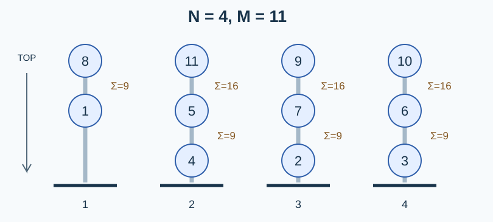

# 平方和球柱的容量：精确整数平方

## 最大数量的证明

记 $C(n)=\lfloor(n+1)^2/2\rfloor-1$ .

**上界。** 设已经放入了 $T=C(n)+1=\lfloor(n+1)^2/2\rfloor$ 个球。考察最大的 $n+1$ 个编号，即 $T-n,\ldots,T$ .其中任意两个不同编号之和严格大于 $n^2$ 且严格小于 $(n+1)^2$ ，所以不能相邻。每根柱子的编号从底到顶严格递增，这些大编号在该柱上必然构成连续的顶端部分；若某柱有两个，就会有两个相邻的大编号，产生矛盾。因此需要至少 $n+1$ 根柱子，上界成立。

**达到上界的构造。** 一根柱子只放球一。对于奇数 $n>1$ ，在当前 $n$ 根柱子上放两层，从顶到底描述如下，局部列编号为 $j=0,\ldots,n-1$ ：

$$\text{上层}_j=C(n)-n+1+j,\qquad \text{下层}_j=C(n)-n-j.$$

再在中间 $n-2$ 根柱子的下方递归放入规模 $n-2$ 的方案。上下两层相邻和为 $n^2$ ；第二层与递归部分第一层的相邻和为 $(n-1)^2$ .剩余相邻关系由归纳保证。两层使用最大的 $2n$ 个编号，因为 $C(n)-C(n-2)=2n$ ，所有编号不重不漏。

对于偶数 $n$ ，最上层从左到右为 $C(n),C(n)-1,\ldots,C(n)-n+1$ ，前 $n-1$ 根柱子的下方放规模 $n-1$ 的方案。相接两层的编号和为 $n^2$ ，并且 $C(n)-C(n-1)=n$ .故也合法且恰好用尽一到 $C(n)$ .

所有列从顶到底严格递减，因此逆向按编号从小到大放入，正好遵守原操作时序。构造与上界合起来证明最优数量就是 $C(n)$ .

## 用 NTT 计算大整数

需要精确计算 $\lfloor(N+1)^2/2\rfloor-1$ .先删除输入的前导零，按低位在前的百进制数字存储 $N$ ，加一后对其数字多项式做平方。平方的卷积系数进位，得到 $(N+1)^2$ ；从高位到低位除以二并丢弃余数，再减一输出。

使用模数 $p=1004535809=479\times2^{21}+1$ 和原根三。$N+1$ 至多有 $100001$ 个十进制位，即至多 $50001$ 个百进制位。每个未经进位的卷积系数不超过

$$50001\times99^2=490059801<p.$$

因此一次模域卷积就能恢复真实整数系数，无需中国剩余定理。变换长度取不小于数字数两倍的最小二次幂，最大为 $2^{17}$ ，避免循环卷积混叠。正变换、逐点平方、逆变换得到所有精确系数；进位、除二、减一均为普通整数运算。模数只是计算卷积的工具，输出没有取模。

## 正确性与复杂度

容量证明给出唯一所需的算式；NTT 系数上界保证恢复的是整数平方。后续百进制运算分别执行取整除法与减一，所以输出正是容量。

设一组数规范化后的十进制位数为 $d$ ，全部输入字符数为 $B$ .总时间为 $O(B+\sum d\log(d+1))$ ，额外空间为 $O(B_{\max}+d_{\max})$ ，其中 $B_{\max}$ 是最长输入数字字符串的字符数。逐组处理，不保存全部询问。快速幂和乘法均使用标准 64 位整数。

## 方案选择与贡献

出题人解法使用容量公式及 NTT 大整数平方。首选 [std.cpp](std.cpp) 保留这一路线，用百进制缩短变换长度，并给出单模数精确性的系数界；这是同一算法的实现优化。GPT-6 完成数值界、流式多组处理和边界实现。

[Karatsuba 解法](solution-alternative.zh.md)及 [alternative.cpp](alternative.cpp) 用三次递归平方代替模域变换，时间为 $O(d^{\log_2 3})$ ，空间为线性量级。它不依赖 NTT 模数和单位根，思路独立且可通过完整数据；NTT 保留为首选，渐进时间更低。两者均经 Python 精确大整数核对，包括最大输入、连续进位与前导零。见[性能记录](../../../docs/benchmark-R24.json)。

