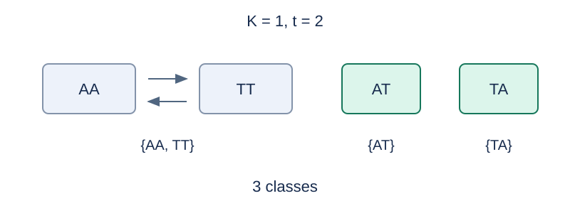

# DNA 双链长度区间计数

预估时间限制：0.5 秒。内存限制：128 MB。

实际时限以标准程序在目标评测环境的最慢用例中位时间乘以 $2$ ，按 $0.5$ 秒向上取整。参考环境见[评测说明](../../../docs/评测环境与性能.md)。

## 背景故事

研究员按长度区间整理一批双链样本。不同记录可能只是同一条样本从另一端读取的结果，需要先确定等同规则，再统计每个区间里的结构种类。

(本故事由GPT-6重写)

## 形式化问题描述

每次询问给出 $L,R,K$ .字母表有 $K$ 对互不相同的互补字母 $a_1,b_1,\ldots,a_K,b_K$ ，共 $q=2K$ 个字母。互补操作交换每对中的两个字母，没有字母与自身互补；字母种类有固定标记。

长度为 $t$ 的双链结构由一个长为 $t$ 的字符串 $s$ 表示，另一条链由互补关系唯一确定。反向互补定义为

$$R_c(s)=\overline{s_t}\,\overline{s_{t-1}}\cdots\overline{s_1}$$

两个表示属于同一个结构，当且仅当它们相等，或互为反向互补。不单独将普通反转、逐位互补或字母种类重命名视为等同。不同长度的结构总是不同。

设 $F(t,K)$ 为长度 $t$ 的结构种类数。输出

$$\sum_{t=L}^{R}F(t,K)\pmod{1000000007}$$

## 输入格式

第一行询问数 $M$ .接下来 $M$ 行，每行三个整数 $L,R,K$ .

## 输出格式

每个询问输出一行，表示模 $1000000007$ 后的非负最小剩余。

## 样例

### 样例 1

### 输入

```text
3
1 1 1
1 4 1
2 3 2
```

### 输出

```text
1
18
42
```

### 样例 2

### 输入

```text
2
1 2 500000004
2 2 1
```

### 输出

```text
500000005
3
```

### 样例 3

### 输入

```text
2
1000000000 1000000000 1
1 1000000000 1000000000
```

### 输出

```text
132812501
50812223
```

## 样例解释

当 $K=1$ 时，长度 1、2、3、4 的结构数分别为 1、3、4、10，所以区间 $[1,4]$ 的答案为 18。样例 2 还包含 $2K\equiv1\pmod{1000000007}$ 的情形。



以 A、T 表示一对互补字母，AA 与 TT 等同，AT 与 TA 分别固定。

## 数据范围与保证

所有数据满足 $1\le M\le100000$ ，$1\le L\le R\le10^9$ ，$1\le K\le10^9$ .询问可以重复。

规格由 Codex（GPT-6）重新设计：明确长度区间上下界与固定字母标记下的反向互补等同规则。

| 分值比例 | 额外条件 |
| --- | --- |
| 20% | $M\le20$ ，$R\le8$ ，$K\le2$ |
| 30% | $M\le1000$ ，$R\le10000$ |
| 50% | 无额外条件 |
