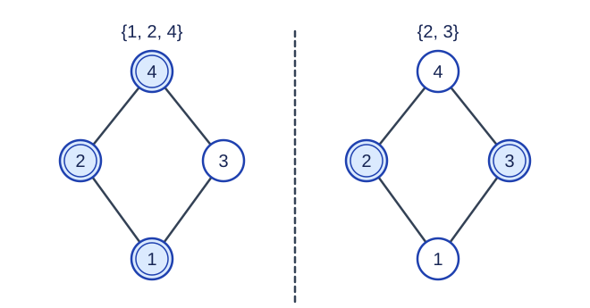

# 子格计数

预估时间限制：1 秒。内存限制：128 MB。

实际时限以标准程序在目标评测环境的最慢用例中位时间乘以 $2$ ，按 $0.5$ 秒向上取整。参考环境见[评测说明](../../../docs/评测环境与性能.md)。

## 背景故事

一个计算模块提供两种二元运算。现在要从全部元素中保留一部分，使保留的元素经过任意一种运算后，结果仍在保留范围内。请统计可以保留的非空元素集合。

(本故事由GPT-6重写)

## 形式化问题描述

给定由 $n$ 个不同元素组成的格 $S$ ，元素编号为 $1,\ldots,n$ .格是一个非空偏序集，其中任意两个元素都有唯一的上确界（不大于任何其他共同上界的共同上界）和下确界（不小于任何其他共同下界的共同下界）。分别记为 $i\lor j$ 与 $i\land j$ .

一个非空子集 $U\subseteq S$ 是子格，当且仅当对任意 $i,j\in U$ ，都有 $i\lor j\in U$ 且 $i\land j\in U$ .这些运算取给定格中的结果。求子格的数量；元素集合不同就视为不同子格，即使结构同构也分别计数。空集不计入，整个格计入。

## 输入格式

第一行整数 $n$ .接下来 $n$ 行，每行 $n$ 个整数，构成矩阵 $A$ .若 $i\le j$ ，则 $A_{i,j}=i\lor j$ ；若 $i\ge j$ ，则 $A_{i,j}=i\land j$ .对角线两种定义一致，均为 $i$ .

上确界与下确界本身都是交换运算；矩阵用两个三角区域分别存储它们，因此矩阵不一定对称。

## 输出格式

输出一行一个整数，表示非空子格的个数。

## 样例

### 样例 1

### 输入

```text
8
1 1 3 7 3 6 7 6 
2 2 3 4 5 6 7 8 
1 2 3 6 3 6 6 6 
2 2 2 4 8 6 7 8 
2 2 5 2 5 6 6 8 
1 2 3 4 5 6 6 6 
1 2 1 4 2 7 7 6 
2 2 5 4 5 8 4 8
```

### 输出

```text
73
```

### 样例 2

### 输入

```text
1
1
```

### 输出

```text
1
```

### 样例 3

### 输入

```text
3
1 2 3
1 2 3
1 2 3
```

### 输出

```text
7
```

## 样例解释

第一组共有 $73$ 个非空子格。第二组只能选择唯一元素。第三组是三元素全序，任意非空子集都对最大值与最小值封闭，共 $2^3-1=7$ 个。



图中编号一是最小元，四是最大元，二和三互不比较。集合 $\{1,2,4\}$ 闭合；集合 $\{2,3\}$ 的两种运算结果分别为四和一，因此不闭合。

## 数据范围与保证

对所有数据，$1\le n\le22$ ，$1\le A_{i,j}\le n$ .保证给定运算确实来自一个格，编号大小不代表偏序中的大小关系。

| 分值比例 | 额外条件 |
| --- | --- |
| 100% | 无额外条件 |
