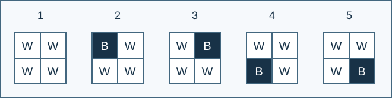

# Boards with No All-Black Line

Indicative time limit: 0.5 seconds. Memory limit: 8 MiB. Recalibrate as twice the slowest standard median in the target environment, rounded up to 0.5 seconds. See the [environment](../../../docs/评测环境与性能.md).

## Story

A princess living on a mountaintop finds ordinary tic-tac-toe too small. On a larger board, she requires a white cell in every row, every column, and both long diagonals. Count the boards she can use.

## Formal Problem Statement

Color every cell of an $n\times n$ board black or white. Every row, every column, the main diagonal, and the opposite diagonal must contain at least one white cell.

The main diagonal consists of $(i,i)$ , and the opposite diagonal consists of $(i,n+1-i)$ , for $1\le i\le n$ . Only these two length-$n$ diagonals are checked. Board positions are distinguished: rotations and reflections are counted separately.

For each $n=0,1,\ldots,20$ , find the number of boards modulo $P=10^9+7$ . The empty board has one coloring by convention.



For $n=2$ , the five valid boards are the all-white board and the four boards with exactly one black cell. W means white and B means black.

## Input Format

There is no input.

## Output Format

Print 21 lines, giving the answers for $n=0$ through $n=20$ , in order.
## Sample 1

### Input

```text

```

### Output

```text
1
1
5
230
38154
23837323
867090702
313119612
923973197
462403141
840792457
982585751
463056058
199254391
8125702
241056829
669505845
625652964
167694588
415136241
104359615
```


## Constraints and Scoring

There is no variable input. All 21 answers must be printed.

Specification adjustment by Codex (GPT-6), recorded as a redesign: the whole-process memory limit is 8 MiB to accommodate the reference Windows runtime overhead. The input domain and counting or queue rules are unchanged.

| Score | Additional constraints |
| --- | --- |
| 100% | None |

There is one formal empty input file worth 100%. See the [test recipes](tests/README.md).
