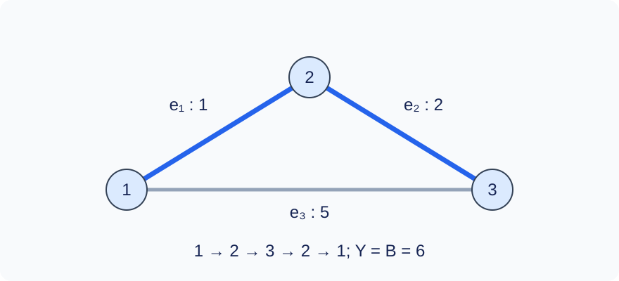

# Lower-Weight Imperfect Non-Matching

Time limit: 0.5 seconds. Memory limit: 128 MiB. Recalibrate as twice the slowest standard median in the target environment, rounded up to 0.5 seconds; see the [environment](../../../docs/评测环境与性能.md).

## Story

“Full preparation can never lead to action!”

You are given a connected undirected weighted graph. Start at vertex $1$ , visit every vertex at least once, return to vertex $1$ , and list the edges you traverse in order.

You do not have to find the shortest walk. A preliminary solution, which need not be optimal, has already been prepared. Your score depends on how your walk's total weight compares with that benchmark. Construct a valid walk that earns full credit.

## Formal Problem Statement

You are given a connected undirected weighted graph with $n$ vertices and $m$ edges. Vertices are numbered $1,\ldots,n$ , and edges are numbered $1,\ldots,m$ in input order. Parallel edges and self-loops are allowed.

Output a sequence of edge IDs describing a walk that starts at vertex $1$ , follows the listed edges in order, visits every vertex at least once, and returns to vertex $1$ . Edges may be reused, but the sequence may contain at most $5n$ edge occurrences. The start is already visited before taking any edge; the empty walk is valid when $n=1$ .

Let $W$ be the minimum spanning tree weight and $B=2W$ . For a valid output, let $Y$ be its total weight, counting repeated traversals separately. Its score out of 100 for one test is

$$s(Y)=\begin{cases}100,&Y\le2B,\\40+\left\lceil\dfrac{60(5B-Y)}{3B}\right\rceil,&2B<Y\le5B,\\40,&Y>5B.\end{cases}$$

Invalid output scores zero. When $B=0$ , the middle branch is impossible: a valid zero-cost walk scores 100 and any other valid walk scores 40. Weight each test's score by the table below. Your task is to output a valid walk earning full credit.

## Input Format

The first line contains `n m` . Each of the next $m$ lines contains `u v w` , describing an undirected edge with endpoints $u,v$ and weight $w$ .

## Output Format

Print the number $k$ of edge occurrences on the first line, followed by one edge ID on each of the next $k$ lines. Any full-credit answer is accepted; sample outputs are not unique.

## Sample 1

### Input

```text
3 3
1 2 1
2 3 2
1 3 5
```

### Output

```text
4
1
2
2
1
```

## Sample 2

### Input

```text
1 0
```

### Output

```text
0
```

## Sample 3

### Input

```text
2 3
1 1 9
1 2 0
1 2 4
```

### Output

```text
2
2
2
```

## Sample 4

### Input

```text
5 5
1 2 1
2 3 1
3 4 1
4 5 1
1 5 3
```

### Output

```text
5
1
2
3
4
5
```

## Sample Explanation

In Sample 1, traversing the tree edges of weights 1 and 2 twice costs 6, exactly the baseline $B$ . In Sample 2, the starting vertex already covers the graph. The five-edge circuit in Sample 4 costs 7 and also earns full credit.



The bold edges form a minimum spanning tree. Traversing edge IDs 1 and 2 out and back visits all three vertices.

## Constraints and Scoring

$1\le n\le10^5$ , $n-1\le m\le2\cdot10^5$ , $1\le u,v\le n$ , and $0\le w\le10^4$ . The graph is connected.

| Score | Additional constraints |
| --- | --- |
| 20% | $n\le8,\ m\le15$ |
| 30% | $n\le1000,\ m\le3000$ |
| 50% | No additional constraints |

There are 10 tests worth 10% each. See the [test recipes](tests/README.md).
