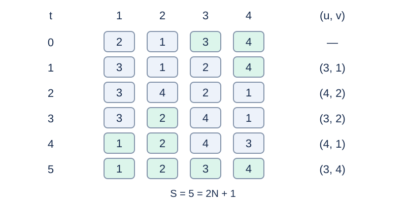

# Restoring Minds after Swaps

## Story

A laboratory device exchanges the minds in two bodies, but the same pair of bodies can never use it again. After an experiment, two volunteers who have never participated help everyone return to their own body.

(This story was rewritten by GPT-6.)

## Formal Problem Statement

There are $N$ bodies and minds, each labeled $1,\ldots,N$ . Initially, mind $i$ is in body $i$ . Execute the $M$ historical swaps in input order. Each swap exchanges the minds currently occupying two specified **bodies**. No unordered body pair repeats in the history.

You may now use two helper bodies $N+1,N+2$ , initially containing their own minds and never involved in a historical swap. Construct at most $2N+1$ additional swaps so that all $N+2$ minds finish in their identically labeled bodies.

Any pair of distinct bodies may occur at most once across the combined history and new swaps. Swaps $(u,v)$ and $(v,u)$ use the same pair. Helpers may be unused, and zero swaps are allowed. A plan satisfying the bound always exists; output any such plan. The task requires the stated bound, not minimum swaps or a minimum number of helpers.

## Input Format

The first line is `N M` . Each of the next $M$ lines gives a historical swap `u v` .

## Output Format

Print the number $S$ of new swaps, followed by $S$ lines of body indices `u v` .

## Sample 1

### Input

```text
2 1
1 2
```

### Output

```text
5
3 1
4 2
3 2
4 1
3 4
```

## Sample 2

### Input

```text
4 2
1 2
3 4
```

### Output

```text
8
5 1
6 2
5 2
6 1
5 3
6 4
5 4
6 3
```

## Sample 3

### Input

```text
1 0
```

### Output

```text
0
```

## Sample Explanation

Sample 1 has only historical swap 1,2. The five displayed steps use bodies 3 and 4 and also restore the helpers. Sample 2 has two disjoint historical swaps; after eight new swaps the helpers also return naturally. Sample 3 is already restored. Valid output is not unique.



Sample 1: each row lists the minds in bodies 1,2,3,4; five new swaps restore all labels.

## Constraints and Scoring

$1\le N\le2\times10^5$ , $0\le M\le2\times10^5$ . Historical endpoints are distinct and in $[1,N]$ , and unordered pairs do not repeat.

Specifications redesigned by Codex (GPT-6): a construction using two helpers within $2N+1$ swaps, plus format, bounds, and validity rules.

| Score | Additional constraints |
| --- | --- |
| 20% | $N\le8,\ M\le20$ |
| 30% | $N,M\le2000$ |
| 50% | No additional constraints |

## Resource Limits

Time: 0.5 seconds. Memory: 128 MiB. The limit is twice the slowest standard-program median over five runs per input, rounded up to 0.5 seconds.

The [output checker](checker.py) verifies the full history, unique unordered pairs, the swap bound, and restoration of every mind. Output need not match the sample text.

[Solution](solution.en.md) · [Measurement environment](../../../docs/评测环境与性能.md) · [Measurements](../../../docs/benchmark-R33.json)
