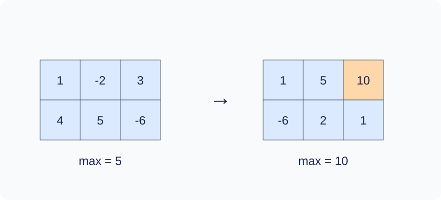

# Rectangle Maximum with Batched Updates

Time limit: 4 seconds. Memory limit: 512 MiB. Recalibrate as twice the slowest standard median in the target environment, rounded up to 0.5 seconds; see the [environment](../../../docs/评测环境与性能.md).

## Story

A greenhouse keeps temperature offsets in a rectangular grid. Sensors upload batches of regional corrections, while the manager queries regional maxima to plan ventilation.

(This story was rewritten by GPT-6.)

## Formal Problem Statement

Given an integer matrix with $n$ rows and $m$ columns, process $Q$ operations in order:

- `1 x1 y1 x2 y2 v` : add $v$ to every cell in the inclusive rectangle $[x_1,x_2]\times[y_1,y_2]$ .
- `2 x1 y1 x2 y2` : print the maximum value in that inclusive rectangle.

Row and column indices start at 1, and endpoints are ordered. Cell values and increments may be negative. A **maximal update run** is a consecutive block of type 1 operations that cannot be extended by another type 1 operation at either end. There are at most 20 such runs. Any number of updates may occur between two consecutive queries.

## Input Format

The first line contains `n m Q` . The next $n$ lines contain $m$ initial values each. Each of the next $Q$ lines contains one operation above.

## Output Format

Print one integer on its own line for each type 2 operation.

## Sample 1

### Input

```text
2 3 5
1 -2 3
4 5 -6
2 1 1 2 3
1 1 2 2 3 7
1 2 1 2 2 -10
2 1 1 2 3
2 2 1 2 3
```

### Output

```text
5
10
2
```

## Sample 2

### Input

```text
1 1 3
-20000
1 1 1 1 1 -20000
2 1 1 1 1
2 1 1 1 1
```

### Output

```text
-40000
-40000
```

## Sample 3

### Input

```text
1 3 3
0 10 20
1 1 1 1 3 3
2 1 2 1 2
2 1 1 1 3
```

### Output

```text
13
23
```

## Sample Explanation

After the two updates in Sample 1, the rows are $[1,5,10]$ and $[-6,2,1]$ . The overall maximum is 10 and the second-row maximum is 2. Sample 2 shows that answers may be negative.



The initial matrix and the matrix after both updates in Sample 1.

## Constraints and Scoring

$1\le n,m$ , $nm\le10^7$ , $1\le Q\le10^5$ , $|a_{ij}|,|v|\le20000$ , $1\le x_1\le x_2\le n$ , and $1\le y_1\le y_2\le m$ . There are at most 20 maximal update runs.

| Score | Additional constraints |
| --- | --- |
| 20% | $nm\le100,\ Q\le100$ |
| 30% | $nm\le10^5,\ Q\le5000$ |
| 50% | No additional constraints |

There are 10 tests worth 10% each. See the [test recipes](tests/README.md).
