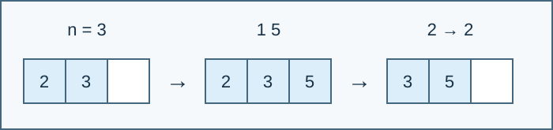

# A Conveyor with Limited Capacity

Indicative time limit: 1 seconds. Memory limit: 8 MiB. Recalibrate as twice the slowest standard median in the target environment, rounded up to 0.5 seconds. See the [environment](../../../docs/评测环境与性能.md).

## Story

A laboratory transports research bottles on an expensive conveyor with limited capacity. An arm adds bottles at the tail and removes them from the head. Simulate the requested operations.

## Formal Problem Statement

An initially empty queue holds at most $n$ signed integers. Process $m$ operations in order:

- `1 x` : append $x$ at the tail if the queue currently contains fewer than $n$ elements; otherwise ignore the operation.
- `2` : if the queue is nonempty, print and remove its head; otherwise ignore the operation and print nothing.

Values may be zero or negative. Both kinds of operation are ignored when the capacity is zero. Encapsulate the queue in a structure.



From left to right: before inserting 5, after inserting 5, and after removing 2. The left end of each list is the head.

## Input Format

The first line contains `n m` . Each of the next $m$ lines describes one operation.

## Output Format

Print one integer for each successful `2` operation. The output is empty if no removal succeeds.
## Sample 1

### Input

```text
3 11
1 1
2
2
1 2
1 3
1 4
1 5
2
2
2
2
```

### Output

```text
1
2
3
4
```


## Sample 2

### Input

```text
0 3
1 0
2
2
```

### Output

```text

```


## Sample 3

### Input

```text
1 6
1 -2147483648
1 7
2
1 0
2
2
```

### Output

```text
-2147483648
0
```


## Constraints and Scoring

$0\le n\le500000$ , $0\le m\le3000000$ , and $-2^{31}\le x\le2^{31}-1$ .

Specification adjustment by Codex (GPT-6), recorded as a redesign: the whole-process memory limit is 8 MiB to accommodate the reference Windows runtime overhead. The input domain and counting or queue rules are unchanged.

| Score | Additional constraints |
| --- | --- |
| 100% | None |

There are 10 formal files worth 10% each. See the [test recipes](tests/README.md).
