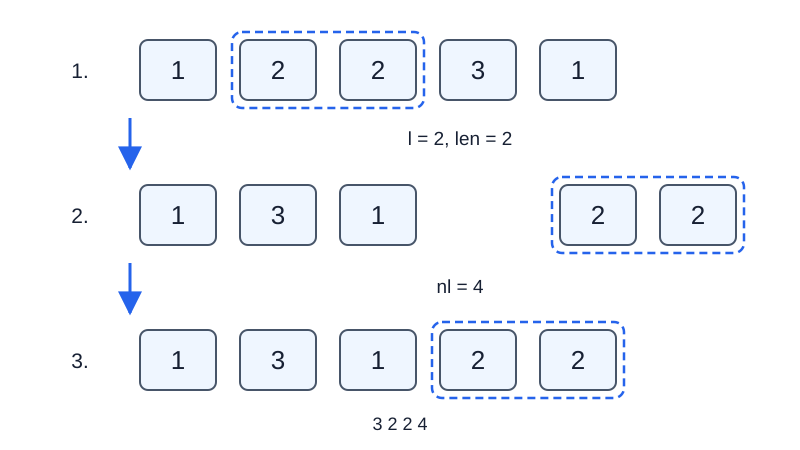

# 土罐的序列

- 参考时间限制：**1.5 秒**（[评测环境与性能](../../../docs/评测环境与性能.md)）。
- 实际时限：在目标环境实测标准程序最慢测试文件的中位时间，乘以 2，再按 0.5 秒向上取整。
- 内存限制：**128 MB**。

## 背景故事

“绝对没有空的！”

“嘿嘿，偶尔有个空的也情有可原。”

土罐把罐子从左到右排成一行，每个罐子属于一种类型。为了调整陈列，他会替换一段罐子的类型、把一段倒过来，或者整段搬到别处。他还想知道某段陈列由多少个连续的同类区段组成。

## 形式化问题描述

给定长度为 $n$ 的序列，位置编号为 $1,\ldots,n$ ，初始类型为 $v_1,\ldots,v_n$ .依次执行 $m$ 次操作：

1. `1 l r v` ：把区间 $[l,r]$ 内所有类型改为 $v$ .
2. `2 l r` ：翻转区间 $[l,r]$ 的顺序。
3. `3 l len nl` ：取出从位置 $l$ 开始、长度为 $\mathrm{len}$ 的连续子序列，保持其内部顺序。将剩余序列重新从 $1$ 编号，然后把取出的子序列插入，使它在最终序列中占据 $[\mathrm{nl},\mathrm{nl}+\mathrm{len}-1]$ .也就是说，插入到剩余序列的前 $\mathrm{nl}-1$ 个元素之后。
4. `4 l r` ：输出区间 $[l,r]$ 中连续相同类型的段数。等价地，答案是 $1$ 加上区间内相邻元素类型不同的相邻对数量。

所有操作都使用当时的序列位置。操作 3 的 $\mathrm{nl}$ 按**取出后的剩余序列**解释，可以插到最前面或最后面。序列总长度始终为 $n$ .

## 输入格式

第一行两个整数 $n,m$ .第二行 $n$ 个整数 $v_1,\ldots,v_n$ .接下来 $m$ 行，每行一个操作，格式如上。

## 输出格式

对每个操作 4，按出现顺序输出一行整数。

## 样例 1

### 输入

```text
6 6
1 1 2 2 3 3
4 1 6
2 2 3
4 1 6
4 2 3
1 5 5 7
4 1 6
```

### 输出

```text
3
5
2
6
```

## 样例 2

### 输入

```text
5 7
1 2 2 3 1
3 2 2 4
4 1 5
2 1 5
4 1 3
1 2 4 2
3 1 5 1
4 1 5
```

### 输出

```text
4
2
2
```

## 样例 3

### 输入

```text
1 5
7
3 1 1 1
2 1 1
1 1 1 9
4 1 1
4 1 1
```

### 输出

```text
1
1
```

## 样例解释

样例 1 首次翻转后，序列为 $[1,2,1,2,3,3]$ ，整列共有 $5$ 段，而位置 $2,3$ 构成 $2$ 段。

样例 2 首先取出位置 $2,3$ 的两个元素，剩下 $[1,3,1]$ ，再插到剩余序列末尾，得到 $[1,3,1,2,2]$ .



虚线框标出被搬移的子序列；数字表示类型。样例 3 覆盖只有一个元素时的搬移、翻转和赋值。

## 数据范围与保证

对 100% 的数据：$1\le n,m\le200000$ ，所有初始及赋值后的类型满足 $1\le v\le10^9$ .

操作 1、2、4 满足 $1\le l\le r\le n$ .操作 3 满足 $1\le l\le n$ ，$1\le\mathrm{len}\le n-l+1$ ，$1\le\mathrm{nl}\le n-\mathrm{len}+1$ .

| 分值比例 | 额外条件 |
| --- | --- |
| 100% | 无额外条件 |
