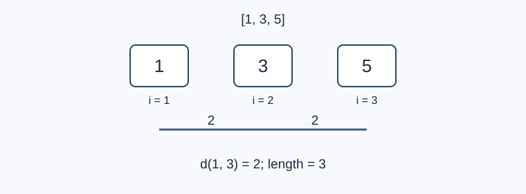

# 催化序列

- 参考时间限制：5.0 秒。
- 实际时限：标准程序在目标环境的最慢用例中位耗时乘以 2，再按 0.5 秒向上取整。
- 内存限制：128 MB。
- [参考评测环境与测量](../../../docs/评测环境与性能.md)

## 背景故事

冒险家按获得顺序摆好了合成材料。不同材料的能量越接近，合成出的催化剂分层度就越低。现在他想为每种分层度选出尽可能长的一段材料。

## 形式化问题描述

给定长度为 $n$ 的正整数序列 $a_1,\ldots,a_n$ ，令 $U=\max_i a_i$ .

对于长度至少为 $2$ 的连续区间 $[l,r]$ ，定义分层度

$$d(l,r)=\min_{l\le i<j\le r}|a_i-a_j|$$

对每个整数 $d=0,1,\ldots,U-1$ ，求分层度**恰好**为 $d$ 的区间的最大长度。不存在这样的区间时，答案为 $0$ .

相同能量可以出现在不同位置；单个材料不构成合法区间。

## 输入格式

第一行一个整数 $n$ .第二行包含 $n$ 个整数 $a_1,\ldots,a_n$ .

## 输出格式

输出 $U$ 行。第 $d+1$ 行为分层度恰好为 $d$ 的最大区间长度。

## 样例 1

### 输入

```text
10
1 3 2 1 4 7 9 8 2 3
```

### 输出

```text
10
7
4
3
0
0
2
0
0
```

## 样例 2

### 输入

```text
1
1
```

### 输出

```text
0
```

## 样例 3

### 输入

```text
3
1 3 5
```

### 输出

```text
0
0
3
0
0
```

## 样例解释

样例一中，整个序列包含相同能量，分层度为 $0$ .区间 $[2,8]$ 的七个数互不相同且包含相邻整数，所以分层度为 $1$ .样例二没有长度至少为 $2$ 的区间。样例三的整个区间分层度为 $2$ .



样例三的整个区间长度为 $3$ ，分层度为 $2$ .

## 数据范围与保证

$1\le n\le100000$ ；$1\le a_i\le250000$ .

| 分值比例 | 额外条件 |
| --- | --- |
| 100% | 无额外条件 |
