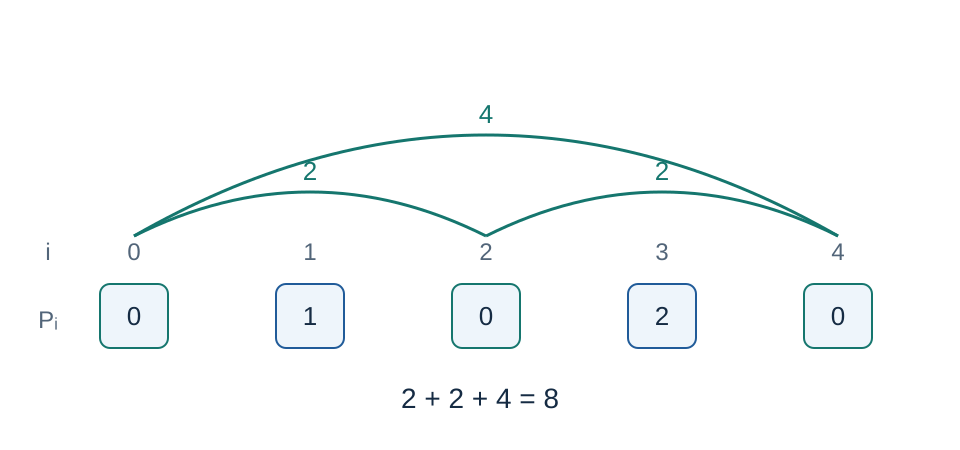

# 端倪发生器：题解

出题人解法：前缀和离散化，按块预处理相同值的次数和下标和，查询时处理整块与两端散块。Codex（GPT-6）补齐完整块区间答案、以出现位置前缀和压缩存储，并给出证明与标准 C++17 实现。前缀和、分块与离散化均为经典方法。

## 相同前缀值之间的距离

令 $P_0=0$ 、$P_i=\sum_{j=1}^i a_j$ .区间 $[s,t]$ 和为零，当且仅当 $P_{s-1}=P_t$ ，其长度为 $t-(s-1)$ .因此一次 $[l,r]$ 询问等价于在前缀下标区间 $[l-1,r]$ 内，求所有同值位置对 $i<j$ 的距离 $j-i$ 之和。

样例的零前缀位于下标零、二、四，三个距离是二、二、四，总和八。前缀和绝对值最多 $10^{14}$ ，先用六十四位求出，再离散化为 $V\le N+1$ 个编号。

## 整块区间答案

将 $N+1$ 个前缀位置按宽度 $B=\lceil\sqrt{N+1}\rceil$ 分块，共 $K=\lceil(N+1)/B\rceil$ 块。预计算 $H[s][t]$ ：从块 $s$ 的起点到块 $t$ 的终点之间，所有同值位置对的距离和。

固定起始块，从其起点向右扫描。对每个值维护已遇次数 $c_v$ 和位置之和 $z_v$ .读到位置 $j$ 时，新增贡献

$$c_vj-z_v$$

正好是它与之前所有同值位置的距离之和，再更新次数和位置和。每到块末存下当前答案。总扫描量 $O(NK)$ ，答案表空间 $O(K^2)$ .

必须存每一整块区间的答案，不能仅用两个全局前缀答案相减：后一个全局答案包含跨越被排除前缀的同值位置对，而相减不会消去这些交叉项。

## 常数时间取得中间区间的同值统计

对每个值 $v$ ，把其所有出现下标升序存入一个位置表，另存位置表的局部前缀和。再保存 $C[b][v]$ ：第 $b$ 块起点之前值 $v$ 的出现次数。

若中间完整块覆盖半开前缀位置区间 $[F,G)$ ，其中 $F,G$ 都是块边界，则两个边界计数给出值 $v$ 在此区间内的出现编号范围。两次局部前缀和相减，就得到下标和。于是次数和下标和均可在 $O(1)$ 时间获得。计数矩阵使用三十二位，位置前缀和使用六十四位，无需为每个块、每个值再保存一份六十四位位置和矩阵。

## 查询分成三类位置对

对前缀位置询问 $[L,R]$ ，取

$$F=(\lfloor L/B\rfloor+1)B,\qquad G=\lfloor R/B\rfloor B.$$

若 $F\ge G$ ，区间长度不超过 $2B$ ，直接扫描并用次数和下标和求答案。否则中间为完整块 $[F,G)$ ，两端散块为 $[L,F)$ 和 $[G,R]$ .

1. 中间与中间的配对直接查 $H$ .
2. 对左散块位置 $i$ ，若中间同值次数为 $c$ 、下标和为 $z$ ，交叉贡献为 $z-ci$ ；右散块则为 $ci-z$ .
3. 按下标递增扫描左散块再扫描右散块，用临时次数和下标和累计所有散块之间的配对。这样也包括左散块与右散块之间的配对。

同一个值在一次查询中只需求一次中间统计，随后缓存复用。查询结束只清空实际访问过的值，不能每次清空整个值域。边界为完整块时仍留至多一块作散块，不影响复杂度。

## 正确性

零和子区间与同值前缀位置对一一对应且长度相等。整块预处理每次只加入以当前位置为右端点的配对，因此 $H$ 精确。位置表及边界次数给出的中间统计精确。任意同值位置对恰好属于“均在中间”“一个在散块一个在中间”“均在散块”之一，上述三步分别完整计入，不重不漏。每次用已求得的精确答案解码下一询问，按询问顺序归纳即可得到全部正确答案。

## 复杂度与数值

预处理 $O(N\log N+NK)$ ，每问 $O(B)$ ；空间 $O(N+KV+K^2)$ .当 $B$ 约为平方根时，最坏时间 $O(N\sqrt N+M\sqrt N+N\log N)$ ，空间 $O(N\sqrt N)$ .矩阵最坏约一亿二千七百万字节，完整工作集见实测。

答案在全零序列时最大，为 $N(N+1)(N+2)/6<1.7\times10^{14}$ .次数乘下标、下标和、答案与异或操作全部使用六十四位；原始字段虽然不超过 $10^9$ ，上一答案不能截成三十二位。查询输出后立即更新上一答案。

首选 [std.cpp](std.cpp) 保留分块方案并提供常数时间中间统计。[出现位置二分方案](solution-alternative.zh.md)与 [alternative.cpp](alternative.cpp) 去掉块乘值矩阵，显著节省空间，每问理论上增加一个对数因子，作为支持完整范围的并列方案。实测速度取决于值的重复程度和矩阵访问，不仅由渐进界决定。

小输入独立枚举子区间。正式数据的每个答案另用莫队区间维护核验：先用候选上一答案解码全部区间，再独立计算这些区间的值；若全部相等，由第一次询问开始归纳可知所有解码也正确。该核验器需要候选答案，所以不作为可独立解密的求解程序。

数据：[plan.json](tests/plan.json)、[generate.py](tests/generate.py)。性能：[测量记录](../../../docs/benchmark-R26.json)。
