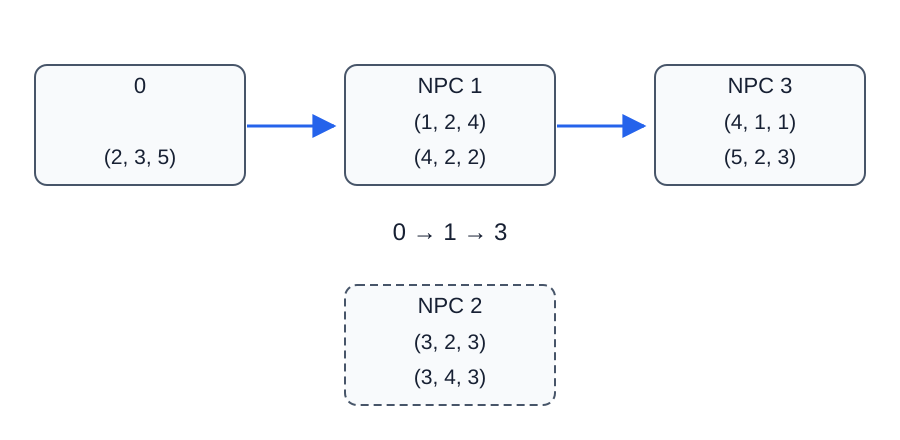

# 契约召唤

- 参考时间限制：**1.0 秒**（[评测环境与性能](../../../docs/评测环境与性能.md)）。
- 实际时限：在目标环境实测标准程序最慢测试文件的中位时间，乘以 2，再按 0.5 秒向上取整。
- 内存限制：**1024 MB**。

## 背景故事

在 DNF 的世界里，召唤师和 NPC 都有力量、智力、精神三个属性。每种 NPC 会检验发起召唤者的属性；愿意响应的 NPC 加入后，也能继续发起召唤。召唤师希望知道最终能召集多少种 NPC。

## 形式化问题描述

给定初始召唤师的属性 $(F,I,S)$ ，以及 $n$ 种 NPC。第 $i$ 种 NPC 有需求 $(f_i,g_i,h_i)$ 和自身属性 $(F_i,I_i,S_i)$ .

一个已经可用的角色可以召唤第 $i$ 种 NPC，当且仅当该角色的力量、智力、精神分别不小于 $f_i,g_i,h_i$ .三项条件必须由**同一个角色**同时满足。

初始时只有召唤师可用。召唤不消耗角色，也不改变任何角色的属性；被召唤的 NPC 此后可以继续召唤其他 NPC。求最终最多能召唤多少种 NPC，每种只计一次，初始召唤师不计入答案。

## 输入格式

第一行四个整数 $n,F,I,S$ .

接下来 $n$ 行，第 $i$ 行六个整数 $f_i,g_i,h_i,F_i,I_i,S_i$ ，前三个为需求，后三个为该 NPC 自身的属性。

## 输出格式

输出一行整数，表示能召唤的 NPC 种类数。

## 样例 1

### 输入

```text
3 2 3 5
1 2 4 4 2 2
3 2 3 3 4 3
4 1 1 5 2 3
```

### 输出

```text
3
```

## 样例 2

### 输入

```text
3 1 1 1
1 1 1 5 1 1
1 1 1 1 5 5
5 5 5 9 9 9
```

### 输出

```text
2
```

## 样例 3

### 输入

```text
3 0 0 0
0 0 0 1 1 1
1 1 1 2 2 2
2 2 2 0 0 0
```

### 输出

```text
3
```

## 样例解释

样例 1 中，初始召唤师可以召唤 NPC 1，它又可以召唤 NPC 3。NPC 2 的三项需求没有被任何可用角色同时满足，因此答案是 $2$ .



图中每个框的前三元组为需求，后三元组为自身属性；起点仅列自身属性。

样例 2 中，不能把两个 NPC 分别擅长的属性合并，因此第三种仍不可召唤。样例 3 可以沿链召唤全部三种 NPC。

## 数据范围与保证

对 100% 的数据：$1\le n\le100000$ ，所有需求和属性均为 $0$ 到 $10^9$ 之间的整数。不同 NPC 可以具有完全相同的需求或属性。

| 分值比例 | 额外条件 |
| --- | --- |
| 100% | 无额外条件 |
