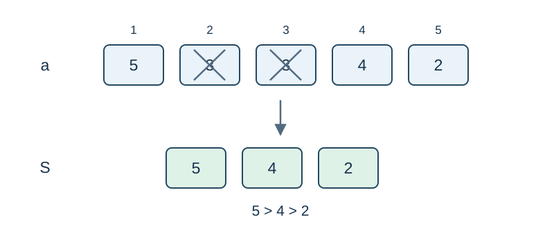

# A Decreasing Stack with Point Updates

Time limit: 0.5 seconds. Memory limit: 256 MiB. See the [reference environment and measurements](../../../docs/评测环境与性能.md).

## Story

An observation station records signal strengths by position. During playback, a new signal removes all top signals that are no stronger. Records can be corrected, and the station needs the number of signals left after each playback.

(This story was rewritten by GPT-6.)

## Formal Problem Statement

Given an integer sequence $a$ of length $n$ , process $m$ operations:

- `1 x v` : set $a_x=v$ .
- `2 l r` : start with an empty stack and insert $a_l,a_{l+1},\ldots,a_r$ in that order. Before pushing a value $v$ , pop while the stack is nonempty and its top is $\le v$ . Print the final stack size.

Queries do not change the sequence. Indices start at $1$ , and each query starts with a fresh stack. Equal values cause a pop, so values from bottom to top are strictly decreasing.

## Input Format

The first line contains `n m` . The second contains the $n$ initial values. Each of the next $m$ lines contains one operation above.

## Output Format

Print one integer on its own line for each query.

## Sample 1

### Input

```text
5 6
5 3 3 4 2
2 1 5
1 1 1
2 1 5
2 2 3
1 3 8
2 2 5
```

### Output

```text
3
2
1
3
```

## Sample 2

### Input

```text
1 3
0
2 1 1
1 1 1000000000
2 1 1
```

### Output

```text
1
1
```

## Sample Explanation

The first query of Sample 1 leaves $[5,4,2]$ . Updating the first value leaves $[4,2]$ ; querying the two equal values $3$ leaves one value.



Insert from left to right; a later value at least as large removes an earlier value.

## Constraints and Scoring

$1\le n,m\le50000$ , $0\le a_i,v\le10^9$ , $1\le x\le n$ , and $1\le l\le r\le n$ .

Specifications redesigned by Codex (GPT-6): the traversal direction, popping on equality, and independent query stacks.

| Score | Additional constraints |
| --- | --- |
| 20% | $n\le50,\ m\le100$ |
| 30% | $n,m\le2000$ |
| 50% | No additional constraints |
