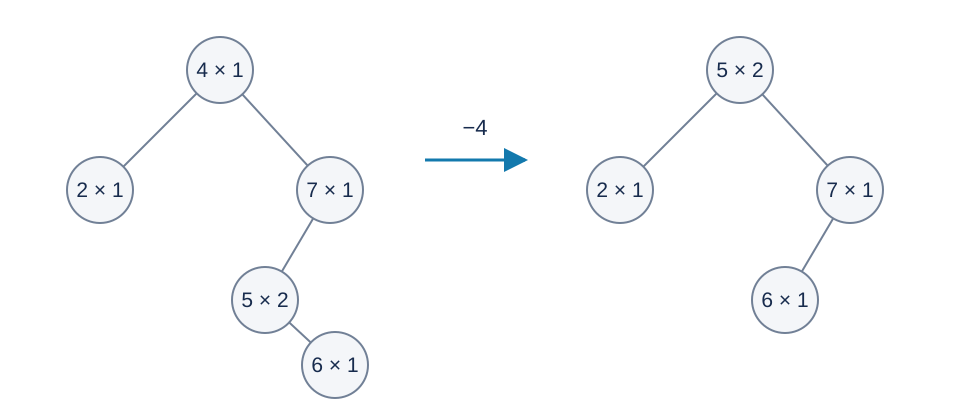

# 保留形状的二叉搜索树：题解

## 解法与贡献

出题人解法是按原树逐边查找、维护重复计数，并用中序后继完成删除。Codex（GPT-6）保留这些树形操作，增加按键值有序的结点索引，将定位操作的最坏复杂度降为对数；同时使用显式前序遍历和安全的完整整数范围读入。二叉搜索树、有序映射及后继删除都是经典方法。

下图对应样例二删除四之前与之后，每个结点标为“键值 × 次数”。后继五的次数二一并移到根，六接替五原来的位置。

## 出题人解法：直接模拟树

结点保存键值、次数和两个孩子。插入从根比较大小，走到空指针时建点，遇到相等值只增加次数。删除同样先查找，次数减为零才处理孩子。

有两个孩子时，到右孩子后不断走左孩子，得到中序后继。交换完整的键值与次数后，删除后继的物理位置。它不可能有左孩子：否则左孩子对应更小的右子树键值，与后继的选择矛盾。因此删除只需把它的右孩子接到其父亲上。

为什么交换后保持搜索关系？后继大于左子树全部键值，也小于右子树中其余全部键值。它替换目标位置合法；原目标键值只临时出现在马上删除的位置。重复次数必须作为数据的一部分整体移动。

前序遍历先打印根，再遍历左、右子树。设各次查找和找后继的访问长度之和为 $H$ ，所有打印行的结点数之和为 $P$ ，直接模拟耗时 $O(M+H+P)$ ，最坏 $O(M^2+P)$ ，空间 $O(M)$ .题面的访问承诺没有给出可代入的数值树高，不能据此宣称对数复杂度。

## 首选实现：独立的有序索引

实际题目树仍保存父亲、左孩子、右孩子、键值与次数，形状严格按上述规则变化。另外用 `std::map` 建立“键值到实际结点编号”的映射。这个映射自己的平衡操作不改变题目树。

### 插入新键

在索引中找到新键的中序前驱 $p$ 和后继 $s$ ：

1. 若 $p$ 存在且没有右孩子，接为 $p$ 的右孩子。
2. 否则若 $s$ 存在，接为 $s$ 的左孩子。
3. 两者都不存在时，新点成为根。

证明该位置与从根查找相同：相邻的中序结点之间没有第三个键值。如果前驱没有右孩子，所有位于这两个键之间的新键都会沿查找路径进入该空右孩子。如果它有右孩子，后继恰为这棵右子树的最左结点，其左孩子必空，新键应插在那里。没有前驱或后继时，相同论证适用于当前最小或最大键。

### 删除和索引同步

查到目标后先减少次数。有两个孩子时，用索引迭代器的下一个元素找到后继，将后继的键值与次数复制到目标位置，并把后继键值的索引改指向目标位置；再物理删除原后继位置。删除原目标键值的索引项。该复制与题目所述“交换后立即删掉原数据”完全等价。

物理删除统一为：令唯一孩子（也可能为空）接替该位置，并更新父亲的相应孩子指针；若删除根则更新根；非空接替孩子的父指针也要更新。不存在的键不创建索引项、不产生负计数。

### 打印与整数边界

显式栈先压右孩子再压左孩子，从而先处理左子树。空树单独输出换行。每个活结点只打印一次。

读入负数时先用六十四位整数累积绝对值，再取符号并转换为键值类型。否则读取 $-2^{31}$ 的绝对值时会先发生有符号三十二位溢出。输出也提升到六十四位再取负。

## 正确性与复杂度

按操作归纳：有序索引始终精确对应每个活键的实际位置；插入选择了普通查找的唯一空位置，删除执行相同的次数更新、后继数据移动与孩子接替，打印遍历相同的连接。因此整个输出与直接模拟完全一致。

每次插删只进行常数次 $O(\log(M+1))$ 的索引操作和常数次连接修改，打印总计 $O(P)$ .总时间 $O(M\log(M+1)+P)$ ，空间 $O(M)$ .索引增加每个活键的存储开销，换取不依赖树高的查找界；这一优势适用于同一份原始范围。[参考程序](std.cpp)采用此方案。
