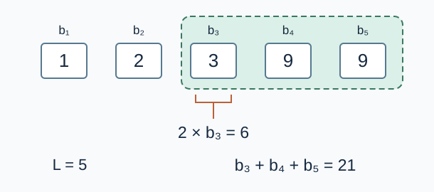

# Interval Medians

Estimated time limit: 0.5 seconds. Memory limit: 128 MB.

On the target judge, multiply the reference program's largest per-case median time by $2$ and round up to a multiple of $0.5$ seconds. See [environment and measurements](../../../docs/评测环境与性能.md).

## Story

An observatory records a sequence of measurements. Report twice the median of every contiguous observation period so that every result is an integer.

(This story was rewritten by GPT-6.)

## Formal Problem Statement

Given an integer sequence $a_1,\ldots,a_n$ , output twice the median of every nonempty contiguous interval $[l,r]$ .

Let $L=r-l+1$ , and let $b_1,\ldots,b_L$ be the interval elements sorted in nondecreasing order. The answer is

$$b_{\lfloor(L+1)/2\rfloor}+b_{\lceil(L+1)/2\rceil}$$

For odd length, this is twice the middle element; for even length, it is the sum of the two middle elements. Equal values at different positions count separately.

## Input Format

The first line contains $n$ . The second line contains $n$ integers $a_1,\ldots,a_n$ .

## Output Format

Print $n(n+1)/2$ lines, each containing one integer. Order intervals by increasing length, and then by increasing left endpoint.

For example, when $n=3$ , the order is $[1,1]$ , $[2,2]$ , $[3,3]$ , $[1,2]$ , $[2,3]$ , $[1,3]$ .

## Examples

### Example 1

### Input

```text
5
2 3 9 9 1
```

### Output

```text
4
6
18
18
2
5
12
18
10
6
18
18
12
12
6
```

### Example 2

### Input

```text
4
-5 0 -5 8
```

### Output

```text
-10
0
-10
16
-5
-5
3
-10
0
-5
```

### Example 3

### Input

```text
1
-1000000000
```

### Output

```text
-2000000000
```

## Example Explanation

The full interval in the first example sorts to $1,2,3,9,9$ , so twice its median is $6$ . The interval $[1,2]$ has median $2.5$ , so its output is $5$ .



The dashed box encloses the three largest values; the bracket marks the middle element $b_3$ . This problem asks for twice the median, namely $6$ .

## Constraints and Guarantees

All inputs satisfy: $1\le n\le10^3$ and $\lvert a_i\rvert\le10^9$ .

| Score | Additional conditions |
| --- | --- |
| 100% | None |
