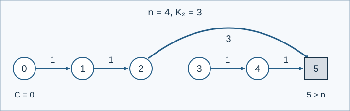

# 分批操作的向前弹跳

参考时间限制：0.5 秒；内存限制：128 MiB。实际时限取目标环境中最慢正式文件的标程中位耗时乘2，再按0.5秒向上取整。见[评测环境](../../../docs/评测环境与性能.md)。

## 背景故事

牧场摆放了一排弹力垫。小羊落在垫子上就会被弹向前方，直到飞出这排垫子。管理员分批调整弹力，并询问小羊会弹跳多少次。

## 形式化问题描述

在整数位置 $0,1,\ldots,n$ 各有一块垫子，初始弹力分别为 $K_0,\ldots,K_n$ ，均为正整数。小羊位于 $i\le n$ 时，进行一次弹跳到 $i+K_i$ ；位置超过 $n$ 时停止。若起点已经大于 $n$ ，弹跳次数为零。

按顺序执行 $q$ 个操作：

- `1 A B` ：把垫子 $A$ 的弹力改为 $B$ .
- `2 C` ：询问从位置 $C$ 出发到停止共需弹跳多少次。询问不会改变弹力。

输出模式由 $t$ 决定。$t=2$ 时，每次询问直接输出答案。$t=1$ 时，处理完全部操作后输出三个整数：奇数编号操作中的询问答案异或和、偶数编号操作中的询问答案异或和、所有询问答案的普通加法总和。**操作编号包含修改**，从1开始；空集合的异或和与加法和都为零。



样例1将 $K_2$ 改为3后，从0出发沿 $0\to1\to2\to5$ 离开，共三次弹跳。

## 输入格式

第一行三个整数 `n q t` .第二行包含 $n+1$ 个整数 $K_0,\ldots,K_n$ .接下来 $q$ 行各为一个操作。

## 输出格式

按指定输出模式输出。$t=1$ 时在一行输出三个整数；$t=2$ 时每个询问输出一行整数，没有询问时输出为空。

## 样例 1

### 输入

```text
4 6 2
1 1 1 1 1
2 0
1 2 3
2 0
2 4
2 9
1 0 1000000000
```

### 输出

```text
5
3
1
0
```


## 样例 2

### 输入

```text
4 6 1
1 1 1 1 1
2 0
1 2 3
2 0
2 4
2 9
1 0 1000000000
```

### 输出

```text
6 1 9
```


## 样例 3

### 输入

```text
1 0 1
1 1
```

### 输出

```text
0 0 0
```

## 数据范围与保证

$1\le n\le300000$ ，$0\le q\le6000000$ ，$t\in\{1,2\}$ ，$1\le K_i,B\le10^9$ ，$0\le A\le n$ ，$0\le C\le10^9$ .

由 Codex（GPT-6）补齐并记录为重新设计：初始弹力统一为正数，精确定义分批条件，内存限制设为128 MiB。

“修改区间”指只包含修改操作的一段连续操作；“询问区间”同理。下表的区间可以自行选择，不要求是极大区间。第4组要求把全部操作依次分段，段与段之间没有遗漏或重叠。

| 分值比例 | 额外条件 |
| --- | --- |
| 25% | $t=1$ ，所有修改位置之和 $\sum A\le50000000$ |
| 25% | $t=1$ ，修改至多100000次；至多100个修改区间覆盖除至多10次之外的全部修改 |
| 25% | $t=2$ ，询问至多100000次；至多100个询问区间覆盖除至多10次之外的全部询问 |
| 25% | $t=2$ ，$q\le1000000$ ；全部操作能分成至多100段，每段涉及位置 $A,C$ 的最大值与最小值之差不超过500 |

第4组生成配方在各段允许范围内随机选择操作类型和位置。共有8个正式文件，每个12.5%，每组两个。

[生成说明](tests/README.md)。
