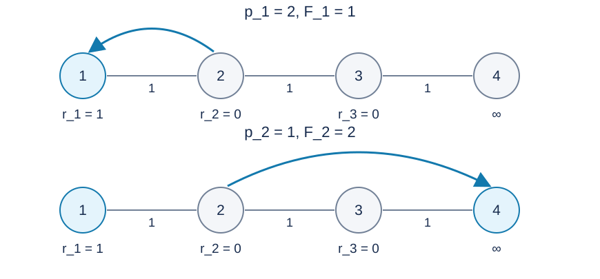

# 直线上的容量运输：题解

## 解法与贡献

采用出题人的残量运输模型、有空位节点集合及按流量符号维护的线段树。Codex（GPT-6）补充最优性证明、可核实的复杂度界和标准 C++17 实现。另提供[分块方案](solution-alternative-blocks.zh.md)及其[程序](alternative-blocks.cpp)，以获得不依赖符号变化次数的工作量上界；线段树作为[首选程序](std.cpp)。

## 净流量与残量费用

令 $f_i$ 为边 $(i,i+1)$ 上向右为正的净运输量。相反方向的运输可以相互抵消，剩余流量可分解为各物品到储位的运输。因此最小费用可以写成
$$
\sum_{i=1}^{n}d_i|f_i|.
$$
向右增加一单位时，该边的增量费用为
$$
d_i(|f_i+1|-|f_i|)=
\begin{cases}-d_i,&f_i<0,\\d_i,&f_i\ge0.\end{cases}
$$
向左增加一单位相当于 $f_i$ 减一：$f_i>0$ 时增量为 $-d_i$ ，否则为 $d_i$ .负的增量表示取消部分已有运输，而非物品具有负距离。

例如下图中 $r_1=1,r_2=r_3=0$ ，三段距离均为一，点四是仓库，请求为 $2,1$ .第一件先存于点一，费用一；第二件到来后，把第一件改存仓库，第二件留在点一，最小总费用为二。直接固定第一件的目的地会错过这种调整。

图中的 $F_j$ 表示前 $j$ 件物品的最小总费用。

## 每次增广为何最优

把道路视为双向费用边，把每个储位连接到汇点。保持前一个前缀的最小费用流，再从新物品的产生点增加一单位流。残量边允许撤销原有运输；已有最优流的残量网络中没有负费用环。

新旧可行流的差可以分解为一条到有空位节点的增广路径，以及非负费用的残量环。因此选择最便宜的增广路径，就得到新前缀的全局最优方案。这个过程可以改变先前物品的安排，符合题意。

在线上，只需比较产生点左右最近的有空位节点。理由如下：从任意有空位节点 $L$ 到更远的有空位节点 $R$ ，残量运输的费用不能为负。否则，在 $L$ 新增一件物品并沿这条路径运输，会得到比原前缀更便宜的方案。然而从任何新增物品后的运输方案中删去那件物品的非负费用运输，就能得到原前缀的方案，故新增物品不可能降低最优费用，矛盾。

一条走向更远空位的路径必须先经过最近空位，其后缀费用非负，所以在最近空位结束不会更差。如果产生点自己有空位，费用零已经最优。

## 数据结构与操作

用有序集合保存仍有剩余容量的节点，并始终保留无限仓库。若产生点已满，查左右最近空位，求两段残量费用，选较小的一侧，在沿途边上统一加一或减一，扣除目的地容量。平局可任选一侧；下一轮只要求当前方案最优，不要求固定某种运输方式。

线段树节点维护三类流量对应的距离和：负、零、正；另维护最大的负流量、最小的正流量、零流量边数及加法懒标记。向右查询返回“零和加正和减负和”，向左查询返回“零和加负和减正和”。

若整段加一或减一不会改变任何边的负、零、正分类，就只更新极值和懒标记。否则向下递归，叶子重新确定分类，再合并各统计量。零距离的边也可能改变流量分类，所以不能用距离和是否为零代替零流量边数。

懒标记只在分类不变时保存，因此即使查询未下推，子节点的三类距离和仍然正确。真正修改子区间之前则必须下推流量变化。

## 复杂度与适用范围

设 $Z$ 为全部操作中叶子流量从一个符号类别进入另一个类别的总次数。一次必须深入的整段更新必包含这种类别变化，可以把额外下降归到相应叶子的祖先路径。因此总时间可界为 $O(n+(m+Z)\log n)$ ，空间为 $O(n)$ .单次更新可能访问整棵树，安全的一般最坏界为 $O(nm)$ ；不能只凭存在懒标记就断言每次更新为对数时间。

分块程序每次操作有确定的块扫描和重排上界，详见补充题解。两份程序均通过完整原范围的正式配方，具体测量见[性能数据](../../../docs/benchmark-R28.json)。线段树在这些数据上较快；时限也为分块程序保留两倍余量。有限压力数据不能证明更强的线段树摊还复杂度。

所有单次路径费用均在约一百二十万的量级，总费用不超过 $m\sum_i d_i$ ，使用六十四位整数。零容量、零距离、同点重复请求和最终全部存入仓库均按同一模型处理。

## 数据与复现

三个样例见题面。[生成配方](tests/plan.json)包含十份计分输入；[生成器](tests/generate.py)只依赖 Python 标准库，支持 --plan、--out-dir、--case 和 --std。正式大输入及可执行文件不放入发布包。时间和内存的参考测量见[性能记录](../../../docs/benchmark-R28.json)。
