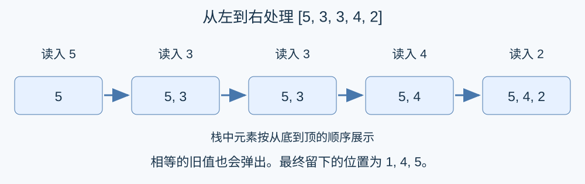

# 小Y的线段树：按右端点处理询问

## 区间栈是前缀栈的一个后缀

一个位置 $i$ 在处理到 $r$ 后仍留在栈中，当且仅当不存在 $i<j\le r$ 使 $a_j\ge a_i$ .若存在，最先遇到的这种值一定会把它弹出；若不存在，后续值都比它小，不会弹出它。因此，一个位置是否保留只取决于其右侧元素。

所以，独立处理 $[l,r]$ 的结果，恰好是处理前缀 $[1,r]$ 的最终栈中所有下标不小于 $l$ 的元素。这个结论对相等元素也成立，因为弹出条件包含等号。

## 算法

把询问按右端点分桶，记录左端点和原询问编号。从左到右扫描序列，用数组维护栈中的**位置下标**。读入 $a_r$ 时，反复弹出满足 $a_{\text{top}}\le a_r$ 的栈顶，再压入 $r$ .

栈中下标始终递增。对所有右端点为 $r$ 的询问，二分查找第一个不小于 $l$ 的下标，其后缀长度就是答案。答案按原编号保存，最后依输入顺序输出。

上述栈操作精确实现题面定义，而保留位置判据证明截取后缀与独立区间处理一致，因此算法正确。

## 复杂度与实现

每个位置入栈一次，最多出栈一次，所有栈操作总计 $O(N)$ .分桶也只需 $O(N+M)$ ，每个询问二分需要 $O(\log N)$ ，所以时间 $O(N+M\log N)$ ，空间 $O(N+M)$ .值和答案均可用 32 位整数。`lower_bound` 查找的是位置，不是栈中数值。

首选 [std.cpp](std.cpp)。完整补充如下，均覆盖全部范围：

| 方法 | 时间 | 空间 | 特点 |
| --- | --- | --- | --- |
| 右端点分桶与单调栈 | $O(N+M\log N)$ | $O(N+M)$ | 首选；线性维护前缀栈 |
| 出题人的离线线段树 | $O(N\log N+M\log M+M\log N)$ | $O(N+M)$ | 用区间最小值与计数维护存活位置 |
| 前驱倍增 | $O((N+M)\log N)$ | $O(N\log N)$ | 预处理后逐条回答，无需保存或排序询问 |

线段树的操作、正确性和摊还分析见[完整题解](solution-alternative.zh.md)与 [alternative.cpp](alternative.cpp)。倍增的路径解释见[完整题解](solution-alternative-binary-lifting.zh.md)与 [alternative-binary-lifting.cpp](alternative-binary-lifting.cpp)。前驱倍增与离线处理的组织不同，用较大的预处理表支持按输入顺序直接回答。

出题人贡献：按右端点排序的删除与区间计数线段树。GPT-6：应用经典单调栈和倍增给出另外两种组织方式，补齐证明、安全实现和双语材料；这些基础方法均非新发明。逐询问直接模拟验证小规模，正式数据同时用独立前驱跳转核对。实际表现见[测量记录](../../../docs/benchmark-R25.json)。
