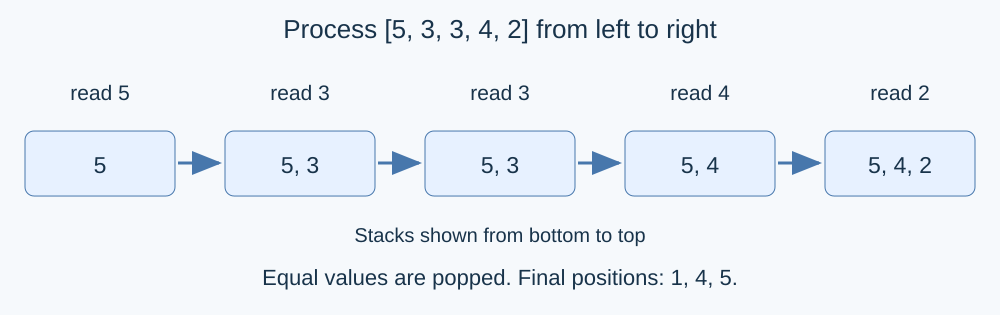

# Little Y's Segment Tree

Estimated time limit: 1.5 seconds. Memory limit: 512 MB.

The limit is ten times the slowest median runtime of the reference program on the target platform, rounded up to a multiple of $0.5$ seconds. See the [evaluation environment](../../../docs/评测环境与性能.md).

This problem uses a multiplier of ten to retain at least twofold measured headroom for the binary-lifting implementation that answers queries as read. See the [individual timings](../../../docs/benchmark-R25.json).

## Story

> “What kind of newbee move is this?”

Little Y is no shut-in. He enjoys playing Bilan and was even a student athlete in primary school, so he has come up with a segment tree problem.

He has a sequence of length $N$. He will tell you its length and the element at every position, yet insists that he will not “give you the sequence.” There are $M$ queries: if the elements in an interval $[l,r]$ are inserted from left to right into an initially empty, strictly decreasing monotone stack, what is its final size?

## Formal Problem Statement

Given an integer sequence $a_1,\ldots,a_N$ and $M$ queries, answer each query $[l,r]$ independently. Start with an empty stack and process $a_l,a_{l+1},\ldots,a_r$ in order. For each value $v$ :

1. While the stack is nonempty and its top is at most $v$ , pop the top.
2. Push $v$ .

The stack is strictly decreasing from bottom to top. In particular, an equal previous value is removed. Report its final size for each query. Queries neither share their stacks nor modify the sequence.

## Input Format

The first line contains $N,M$ . The second contains $a_1,\ldots,a_N$ . Each of the next $M$ lines contains $l,r$ .

## Output Format

Print $M$ lines, with the answer to query $i$ on line $i$ .

## Samples

### Sample 1

### Input

```text
5 4
5 3 3 4 2
1 5
2 4
2 3
5 5
```

### Output

```text
3
1
1
1
```

### Sample 2

### Input

```text
2 1
1 2
1 2
```

### Output

```text
1
```

### Sample 3

### Input

```text
3 2
9 7 5
1 3
2 3
```

### Output

```text
3
2
```

## Sample Explanation

The first sample leaves $(5,4,2)$ , $(4)$ , $(3)$ and $(2)$ from bottom to top. Of the two equal threes, only the later one survives. In the second sample, two removes one. Both intervals in the third sample are already strictly decreasing.



## Constraints and Guarantees

$1\le N,M\le5\times10^5$ , $0\le a_i\le10^9$ , $1\le l\le r\le N$ .

| Score | Additional constraints |
| --- | --- |
| 100% | None |
