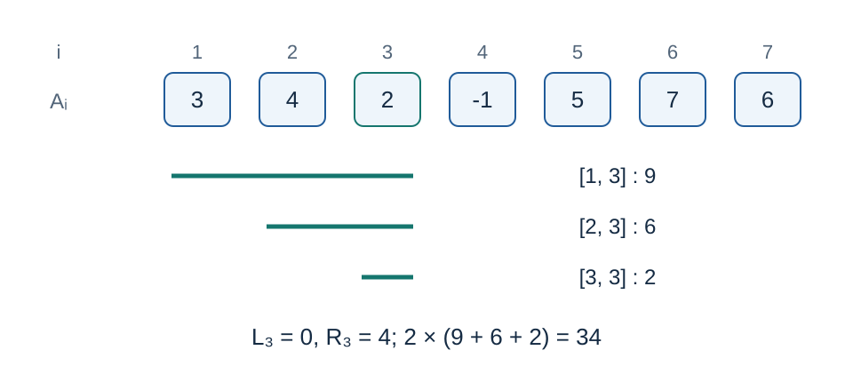

# 最小值加权的区间和：题解

出题人解法：单调栈划分每个最小值负责的区间，再用二重前缀和汇总。Codex（GPT-6）补充严格的相等值归属、数值界、可移植一百二十八位算术、证明与实现。单调栈和前缀和均为经典方法。

## 把区间交给唯一的最小值位置

有多个相等最小值时，把区间交给最右边的那个位置。对位置 $i$ ，令 $L_i$ 是它左边最近的严格更小位置，令 $R_i$ 是右边最近的小于等于它的位置。不存在时分别取 $0,N+1$ .

位置 $i$ 负责的区间恰好是

$$L_i<l\le i\le r<R_i.$$

这里左边允许相等值，右边不允许，确保每个区间只有一个负责人。用严格递增的单调栈保存位置；读入 $A_r$ 时弹出所有值不小于它的位置。对于被弹出的 $i$ ，当前下标给出 $R_i=r$ ，弹出后的栈顶给出 $L_i$ .数组读完后令右边界为 $N+1$ ，显式清空栈。下标零只作为边界标记，不参与比较，避免依赖不够小的哨兵。

图中 $A_3=2$ ，$L_3=0,R_3=4$ .它负责 $[1,3]$ 、$[2,3]$ 、$[3,3]$ ，贡献为 $2(9+6+2)=34$ .

## 二重前缀和

定义 $P_j=\sum_{k=1}^{j}A_k$ ，$P_0=0$ ，以及

$$Q_j=\sum_{k=0}^{j-1}P_k,\qquad Q_0=0.$$

固定负责人 $i$ ，简写 $L=L_i,R=R_i$ .其负责区间的区间和之和为

$$\begin{aligned}S_i&=\sum_{l=L+1}^{i}\sum_{r=i}^{R-1}(P_r-P_{l-1})\\&=(i-L)(Q_R-Q_i)-(R-i)(Q_i-Q_L).\end{aligned}$$

第一项把所有右端点前缀和各重复 $i-L$ 次，第二项把所有左端点之前的前缀和各重复 $R-i$ 次。答案即 $\sum_i A_iS_i$ .

读取到下标 $r$ 时，已经计算到 $Q_{r+1}$ ，因此弹栈需要的 $Q_r$ 已存在。每个位置只入栈、出栈一次。

## 负数与精确整数范围

负数不会影响最小值归属或前缀和恒等式。设 $U=10^9$ .长度为 $d$ 的区间贡献绝对值至多 $U^2d$ ，故全部贡献的绝对值总和不超过

$$U^2\sum_{d=1}^{N}d(N-d+1)=U^2\frac{N(N+1)(N+2)}6.$$

在最大输入下，这个值为

$$166666716666670000000000000000000000000<2^{127}-1.$$

因此有符号一百二十八位足够，六十四位不足。$P_j$ 的绝对值至多 $10^{16}$ ，可以使用六十四位；$Q_j$ 必须使用宽整数。先在宽整数中计算 $S_i$ 的两个部分及其差，再乘 $A_i$ .不要先对二重前缀的两项分别乘 $A_i$ ，也不要先用三十二位计算下标乘积。每个完整负责人贡献及任意已经累加的负责人贡献，均受上述“所有区间绝对贡献总和”限制。

标准 C++17 没有规定一百二十八位整数类型。[std.cpp](std.cpp) 的 `FWide` 用两个无符号六十四位字保存补码：

- 加法先加低字，再把进位加入高字；负号按位取反后加一。
- 乘三十二位有符号数时先取绝对值，把被乘数拆成四个三十二位字，逐字乘并传递进位，再恢复符号。
- 每个单字乘积与进位都能放入无符号六十四位数。内部按模 $2^{128}$ 运算，而已证明的真值范围保证结果对应正确的有符号整数。
- 输出先取绝对值，按从高字到低字的顺序做十进制除法，收集余数；零与负数分别处理。

补充方案使用的六十四位乘六十四位同样按两个三十二位字作乘法，得到四字结果。算术辅助类型单独与 Python 任意精度整数做了符号、进位、借位、乘法和十进制输出核对。

## 正确性与复杂度

左右边界保证每个非空区间恰好归属一个最右最小值。二重前缀和恒等式精确汇总该位置负责的所有区间和，乘其最小值后即得这些区间的总贡献。负责人区间两两不交且覆盖全部区间，所以累加得到所求答案。宽整数的范围与逐字运算保证计算保持精确。

时间 $O(N)$ ，空间 $O(N)$ .数组主体包含四字节值、十六字节二重前缀和及四字节栈下标，每项约二十四字节，最大约二亿四千万字节。

## 并列方案与验证

首选程序保留出题人的最小值归属与二重前缀和结构。[按右端点维护分组](solution-alternative.zh.md)及其 [alternative.cpp](alternative.cpp) 以另一个动态规划不变量逐项读入，同为线性时间和空间，无需保存值数组与二重前缀数组，最大栈项则较大。当前测量中它的运行时间更短；两者均支持完整范围，具体数据见[测量记录](../../../docs/benchmark-R26.json)。

小规模独立枚举全部区间；全部正式输出另由笛卡尔树子树聚合及独立宽整数运算核对，包括精确上界、负答案、相等最小值、单调和混合正负序列。数据见 [plan.json](tests/plan.json) 与 [generate.py](tests/generate.py)。
