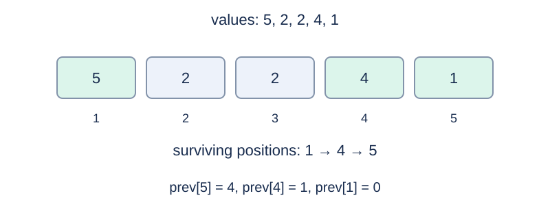

# Old Y's Segment Tree

## Story

> Even if I die and am nailed into a coffin, I will still cry out in a decaying voice: “I want to quit the contest! I want to retire from competitive programming! I want to take the gaokao!”

Old Y is a shut-in who enjoys playing galgames, so he writes a segment tree. However, he only knows how to write a reference solution, not a brute-force one. He asks you to write a brute-force program for him—and perhaps put his reference solution to shame.

His program has enormous constant factors, so he wants to take his frustration out on offline algorithms by making them fail: every query is encrypted using the previous answer, which is taken to be zero before the first query.

Given a sequence of length $N$, answer $M$ queries. Each query inserts the elements of an interval $[l,r]$ from left to right into an initially empty monotone stack and asks for its final size. The precise monotonicity and popping rules are specified below.

## Formal Problem Statement

Given $a_1,\ldots,a_N$ , answer queries on intervals $[l,r]$ . Start with an empty stack and process $a_l,\ldots,a_r$ in order. Before pushing a value, pop every top value less than or equal to it. Report the final stack size.

The input gives encoded endpoints $u,v$ . Let $last$ be the previous answer, initially $0$ . Compute

$$x=((u\mathbin{\mathrm{XOR}}last)\bmod N)+1,\qquad y=((v\mathbin{\mathrm{XOR}}last)\bmod N)+1,$$

then set $l=\min(x,y),r=\max(x,y)$ . Decode both endpoints with the same old answer, and update $last$ after answering. XOR denotes bitwise exclusive OR on nonnegative integers.

## Input Format

The first line is `N M` ; the second contains the $N$ integers $a_i$ . Each of the next $M$ lines gives encoded endpoints `u v` .

## Output Format

Print one stack size per query.

## Sample 1

### Input

```text
5 3
5 2 2 4 1
0 4
2 0
2 4
```

### Output

```text
3
1
2
```

## Sample 2

### Input

```text
4 2
7 7 7 7
0 3
0 2
```

### Output

```text
1
1
```

## Sample 3

### Input

```text
1 2
0
2147483647 0
0 2147483647
```

### Output

```text
1
1
```

## Sample Explanation

The first interval in sample 1 is [1,5], leaving stack 5,4,1 and answer 3. The next encoded endpoints 2,0 decode to [2,4], whose answer is 1. Sample 2 shows that equal older values are popped. Sample 3 uses a singleton array and the largest encoded value.



Surviving positions in the first query of sample 1 and their previous-strictly-greater pointers.

## Constraints and Scoring

$1\le N,M\le50000$ , $0\le a_i\le10^9$ , and $0\le u,v<2^{31}$ .

Specifications redesigned by Codex (GPT-6): scan direction, equal-value handling, and encoded endpoint bounds.

| Score | Additional constraints |
| --- | --- |
| 20% | $N\le30,\ M\le100$ |
| 30% | $N,M\le2000$ |
| 50% | No additional constraints |

## Resource Limits

Time: 0.5 seconds. Memory: 1024 MiB.

The limit is 2 times the slowest standard-program median across five runs per formal input, rounded up to 0.5 seconds.

[Measurement environment](../../../docs/评测环境与性能.md) · [Measurements](../../../docs/benchmark-R32.json) · [Solution](solution.en.md)
