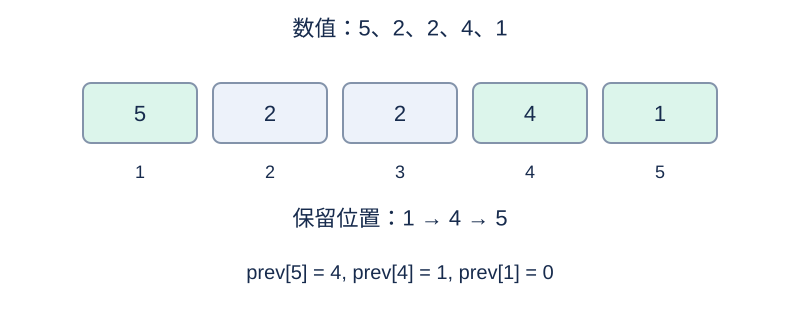

# 老Y的线段树

## 背景故事

> 我即便是死了，被钉在棺材里，也要用腐朽的声音喊出:“我要退赛！我要退役！我要高考！”

老Y是个死宅，喜欢推gal，于是他写了一棵线段树。然而，他只会写标程，不会写暴力，所以想请你帮他写一份暴力程序——顺便“踩”一下他的标程。

他的程序常数巨大，于是想卡掉离线算法来出气：每次询问都用上一次的答案加密，第一次询问前的答案视为零。

给定一个长度为 $N$ 的序列，共有 $M$ 次询问。每次把区间 $[l,r]$ 中的元素从左到右依次放入一个初始为空的单调栈，询问最终栈的大小。具体的单调方向和弹栈规则如下。

## 形式化问题描述

给定 $a_1,\ldots,a_N$ .查询区间 $[l,r]$ 时，从空栈开始，依次处理 $a_l,\ldots,a_r$ ：先弹出所有小于或等于当前值的栈顶，再压入当前值。输出最后的栈大小。

实际输入为编码端点 $u,v$ .令上一次答案为 $last$ ，第一条查询前为 $0$ .先计算

$$x=((u\mathbin{\mathrm{XOR}}last)\bmod N)+1,\qquad y=((v\mathbin{\mathrm{XOR}}last)\bmod N)+1,$$

再令 $l=\min(x,y),r=\max(x,y)$ .两端点使用同一个旧答案解码；输出答案后更新 $last$ .XOR 是非负整数的逐位异或。

## 输入格式

第一行 `N M` ，第二行是 $N$ 个整数 $a_i$ .接下来 $M$ 行，每行两个编码端点 `u v` .

## 输出格式

每个查询输出一行栈大小。

## 样例 1

### 输入

```text
5 3
5 2 2 4 1
0 4
2 0
2 4
```

### 输出

```text
3
1
2
```

## 样例 2

### 输入

```text
4 2
7 7 7 7
0 3
0 2
```

### 输出

```text
1
1
```

## 样例 3

### 输入

```text
1 2
0
2147483647 0
0 2147483647
```

### 输出

```text
1
1
```

## 样例说明

样例 1 的首个区间是 [1,5]，最终栈为 5、4、1，答案 3；下一条编码端点 2、0 解码为 [2,4]，答案 1。样例 2 展示相等旧值会被弹出。样例 3 展示单元素区间与编码上界。



样例 1 首次查询留下的位置，以及向前的严格更大元素指针。

## 数据范围与分组

$1\le N,M\le50000$ ，$0\le a_i\le10^9$ ，$0\le u,v<2^{31}$ .

规格由 Codex（GPT-6）重新设计：明确栈的扫描方向、相等值处理和编码值范围。

| 分值 | 额外限制 |
| --- | --- |
| 20% | $N\le30,\ M\le100$ |
| 30% | $N,M\le2000$ |
| 50% | 无额外限制 |

## 资源限制

时间 0.5 秒；内存 1024 MiB。

时限取标准程序正式数据五次运行的最慢中位数的 2 倍，向上取整到 0.5 秒。

[测量环境与方法](../../../docs/评测环境与性能.md) · [测量记录](../../../docs/benchmark-R32.json) · [题解](solution.zh.md)
