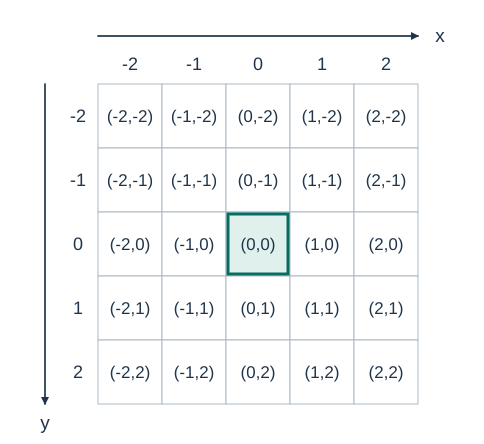
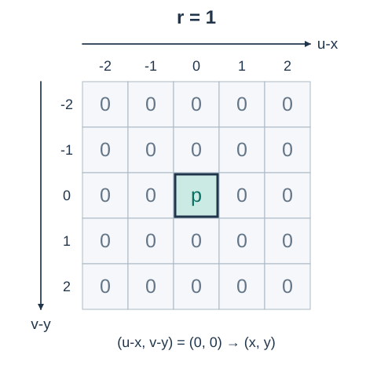
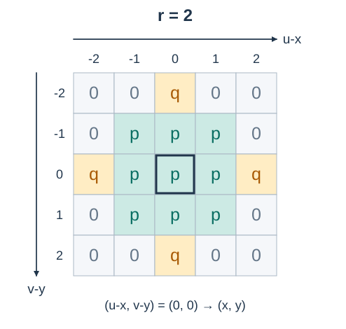
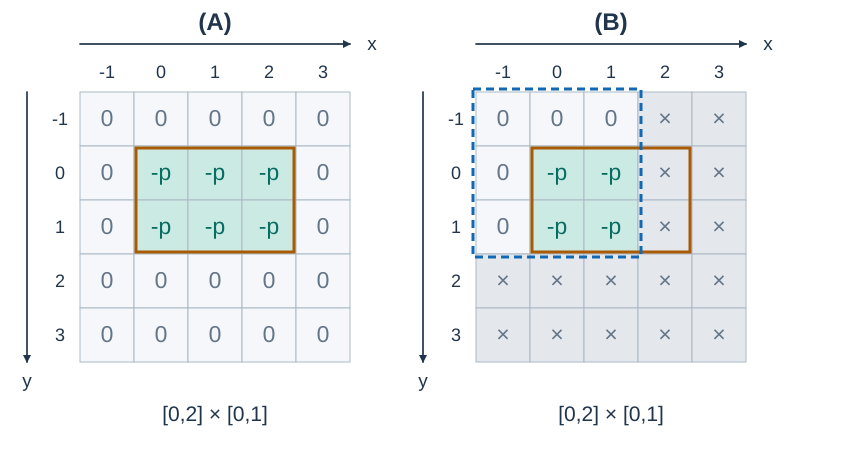

# Psychic Commando

- Indicative time limit: 0.5 s (reference environment: [environment and measurements](../../../docs/评测环境与性能.md); for guidance only)
- Actual time limit: 2 times the reference solution's baseline runtime on its slowest official test file in the target judging environment, rounded up in 0.5 s increments; if the judge supports only coarser increments, round up again to a supported value.
- Memory limit: 128 MB

## Story

Yuri plans to airdrop a Psychic Commando team into a training base. The team can control enemy minds, but persuading a radiation meter to stop beeping is outside its job description.

Bombardments keep increasing the recorded radiation, while decontamination vehicles lower readings in selected areas. An overenthusiastic cleanup can even produce negative readings. Headquarters has postponed the calibration debate: for now, report the exact sum currently recorded in each candidate area.

(This story was rewritten by GPT-6 Astra.)

## Formal Problem Statement

The battlefield consists of cells at integer coordinates. Only cells in $[X_{\min},X_{\max}]\times[Y_{\min},Y_{\max}]$ are recorded, initially with value $0$ . Cells outside this region do not participate in updates or queries. The $x$ coordinate increases rightward and $y$ increases downward.



Figure 1: The coordinates inside a cell identify the whole cell. The bold outline marks the origin $(0,0)$ .

Write $(u,v)$ for the coordinates of an arbitrary cell. Process $m$ operations in order:

- `0 x_1 y_1 x_2 y_2` : sum the values in the intersection of the closed rectangle $[x_1,x_2]\times[y_1,y_2]$ with the recorded region. An empty intersection has sum $0$ .
- `1 x y r p` : bombardment centered at $(x,y)$ . If $r=1$ , only the center cell gains $p$ . If $r\ge2$ , cells satisfying $\lvert u-x\rvert<r$ and $\lvert v-y\rvert<r$ gain $p$ . Cells satisfying either condition below gain $\lceil p/4\rceil$ :
  - $\lvert u-x\rvert=r$ and $\lvert v-y\rvert<r-1$ ;
  - $\lvert v-y\rvert=r$ and $\lvert u-x\rvert<r-1$ .
- `2 x_1 y_1 x_2 y_2 p` : subtract $p$ from each recorded cell in the closed rectangle. Negative results are allowed and are not clamped to zero.

Updates accumulate. Bombardment centers, query rectangles, and cleanup rectangles may lie outside the recorded region.

Let $q=\lceil p/4\rceil$ . Each cell below is labeled with its increment $p$ , $q$ , or $0$ ; $0$ means the bombardment leaves that cell unchanged. The horizontal and vertical offsets are $u-x$ and $v-y$ . The bold outline marks the bombardment center $(x,y)$ . These two figures show the pattern before clipping to the recorded region.



Figure 2: When $r=1$ , only the center is affected.



Figure 3: When $r=2$ , the central nine cells each gain $p$ and the four fringe cells each gain $q$ . The four corners are unaffected.



Figure 4: The solid orange outline marks the closed cleanup rectangle $[0,2]\times[0,1]$ , including its boundary cells. Panel A assumes all displayed cells are recorded, so six cells each lose $p$ . In panel B, the dashed blue outline marks the recorded region $[-1,1]\times[-1,1]$ ; only the four cells in the intersection lose $p$ . Crosses on gray cells mark unrecorded cells. A $0$ means this operation does not change the cell's value.

## Input Format

The first line contains $m,X_{\min},Y_{\min},X_{\max},Y_{\max}$ .

The following $m$ lines describe operations in the formats above.

## Output Format

For every operation of type `0` , output one integer on its own line.

## Sample 1

### Input

```text
8 0 0 10 10
2 0 5 0 5 50
0 0 3 0 5
1 5 5 1 100
0 5 5 5 5
1 5 5 2 40
0 5 5 6 6
1 5 5 5 400
0 6 10 6 10
```

### Output

```text
-50
100
260
100
```

### Explanation

The first cleanup produces a negative value. After the second bombardment, the four cells in $[5,6]\times[5,6]$ contain $140,40,40,40$ . The final queried cell lies in a fringe strip and gains $400/4=100$ .

## Sample 2

### Input

```text
5 -1 -1 1 1
1 0 0 2 5
0 -100 -100 100 100
2 0 0 10 10 10
0 -1 -1 1 1
0 2 2 3 3
```

### Output

```text
45
5
0
```

### Explanation

All nine recorded cells gain $5$ . Cleanup affects only four cells in the intersection, reducing the sum from $45$ to $5$ . The last query is disjoint from the recorded region.

## Constraints and Guarantees

- $1\le m\le30000$ . All input coordinates have absolute value at most $10^8$ .
- $X_{\min}\le X_{\max}$ and $Y_{\min}\le Y_{\max}$ . Each coordinate span is at most $1000$ , so each dimension contains at most $1001$ cells.
- Query and cleanup rectangles satisfy $x_1\le x_2$ and $y_1\le y_2$ .
- $1\le r\le10^8$ and $0\le p\le10^4$ . All input values are integers.
- Operation types are $0,1,2$ . There may be no queries. Initial values are zero, and negative values are allowed.

### Test Groups

| Score share | Additional conditions |
| --- | --- |
| 20% | $m\le10000$ ; at least one coordinate span equals $0$ |
| 20% | $m\le10000$ ; at least one coordinate span is at most $50$ |
| 20% | $m\le10000$ ; all queries follow all updates |
| 20% | $m\le10000$ |
| 20% | No additional conditions |
