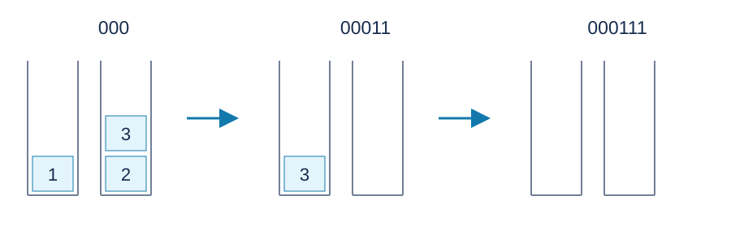

# A Queue Made of Stacks — Solution

## Method and Contributions

Use the setter's greedy strategy and bottom-marker simulation. Codex (GPT-6) supplies the cost and exchange arguments, empty-string handling and portable C++17 implementation. Stacks and queues are classical data structures.

The diagram shows two stacks after prefixes `000` , `00011` and `000111` . Numbers are arrival indices and stack tops are at the top. Element three has been transferred once in the middle state.

## Keep Only Elements That Will Be Dequeued

Simulate the queue length to count effective dequeues, $V$ . Exactly the first $V$ enqueued elements need storage; number them $1,\ldots,V$ by arrival. Later elements may be discarded. Keeping them cannot help earlier outputs and can only occupy space or require additional operations.

Every retained element needs one initial push and one output pop, contributing $2V$ . Each transfer costs another two, so minimize transfers.

## The Actual Greedy Execution

On enqueue, use an empty stack when available. Otherwise push the element above the immediately preceding arrival.

On dequeue, move any elements above the required element one by one to another stack, preferring a nonempty stack, then output the required element. This reverses a segment into FIFO order, allowing all its moved elements to be output later without another transfer.

Two structural properties explain feasibility. An untransferred consecutive arrival segment runs from older to newer bottom-to-top. A transferred segment runs in output order top-to-bottom. When a segment must be reversed, all earlier elements have left; bottoms of other occupied stacks belong to later arrival segments, so the reversed segment can sit above them. New arrivals start a fresh stack when possible, or extend the latest arrival segment, without covering a transferred segment that must leave earlier.

Thus an element initially placed at an empty stack bottom needs no transfer and costs two. Every other retained element is transferred exactly once and costs four.

## Optimality by Exchanging Empty Slots and Transfers

Count each transfer, of cost two, as one unit. Any optimal execution can be put in the greedy form without increasing its units using these exchanges.

**Use an available empty stack.** Putting the new element at its bottom cannot block an existing element. If the original execution later needs this empty stack for older elements, place those older elements above the new one instead: they must all leave first. Existing transfers do not increase, and the new element no longer has to move for an older element beneath it.

**Do not move old elements early merely to make a slot when all stacks are occupied.** A new element pushed onto an occupied stack must move before the older element beneath it can leave, costing at least one unit. Making an empty stack first also costs at least one unit: some transfer must move the last old element off a previously occupied stack. Reassign that unit to a later transfer of the new element. Leave the old element in its stack and attach the new element to the latest arrival segment. The old element leaves earlier, releasing its original stack by that time for a subsequent reversal; further arrivals in the meantime extend the same segment. This exchange does not delay an empty slot needed by an earlier element and does not increase the total transfer allowance. Repeating it eliminates transfers performed solely to make room for new input.

**Attach overflow elements to the latest arrival segment.** Placing a new element above an earlier segment can only obstruct outputs earlier. Move it and its subsequent consecutive arrivals to the latest segment instead. Earlier outputs are unobstructed, and when that segment must leave, one reversal puts the new elements in output order. If the original execution scattered them, each still needed at least one transfer. Keeping them together adds no transfer and releases earlier segments' stacks as soon as possible.

Apply these exchanges in operation order while preserving outputs already fixed. The resulting execution uses an empty stack whenever possible, otherwise extends the latest segment, and reverses only when required for output. A reversal should use a nonempty stack when possible: older elements safely sit above later ones, while consuming another empty stack cannot reduce the current transfers and may block a later direct placement.

The greedy execution pays precisely one unit for each element requiring a transfer, so its total is optimal. The argument is not that a currently full collection of stacks forces that particular new element to move under every possible plan: moving an old element early may create room, but the exchanges show that it cannot reduce total cost.

## Simulate Only Stack Bottoms

Actual contents are unnecessary. Maintain the empty-stack count $E$ , retained arrival count $P$ , dequeue count $Q$ , and `Bottom[x]` , indicating whether element $x$ currently occupies a stack bottom.

- On enqueue while $P<V$ , if $E>0$ , decrease $E$ , mark the new element as a bottom, and add two to the answer. Otherwise add four.
- On an effective dequeue, increment $Q$ and increase $E$ if that element is marked as a bottom.
- After either operation, if $P>Q$ but $E=n$ , a reversed segment has actually occupied an empty stack. Set $E=n-1$ and mark the latest arrival $P$ as its bottom. Its transfer was already charged; do not charge another two.

The last rule restores occupancy hidden by the bottom-only representation. The latest element in a reversed segment is its bottom.

## Complexity and Implementation

Two scans take $O(m)$ time and $O(m)$ space. Allocate by the operation count, not the potentially billion-sized stack count. Since $V\le\lfloor m/2\rfloor$ , the answer is at most $4V\le2m$ and fits a signed thirty-two-bit integer. For $m=0$ , do not read a string; the answer is zero. See the [reference program](std.cpp).

Explicit stacks and transfers construct a legal execution of the same cost, but bottom markers suffice to compute the answer. Small cases can also be checked by a shortest-path search over all stack configurations with the required time windows; that state space does not scale to the full constraints.
