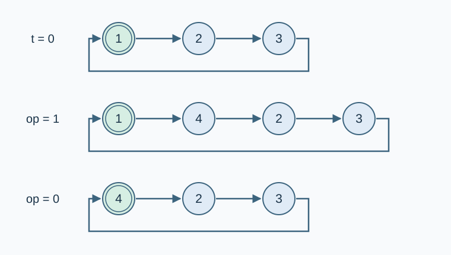

# 异星工厂：机器人指令平台

预估时间限制：0.5 秒。内存限制：128 MB。

实际时限以标准程序在目标评测环境的最慢用例中位时间乘以 $2$ ，按 $0.5$ 秒向上取整。参考环境见[评测说明](../../../docs/评测环境与性能.md)。

## 背景故事

异星工厂中的机器人依靠指令平台协调工作。平台按环形网络依次相连；随着矿区停产与新产线投入使用，需要删除或增设平台，并在网络中移动当前控制位置。

## 形式化问题描述

初始有 $n$ 个平台，编号为 $1,2,\ldots,n$ ，按此顺序组成环，当前平台为 $1$ .

沿 $1\to2\to\cdots\to n\to1$ 为方向 $0$ ，反向为方向 $1$ . 插入或删除后仍按环中的相邻关系定义这两个方向。

依次执行 $m$ 个操作：

- `0` ：删除当前平台，并将其在方向 $0$ 的后继设为当前平台。若仅剩一个平台，则环变空；空环上忽略此操作。
- `1` ：在当前平台与其方向 $0$ 的后继之间插入新平台，当前平台保持不变。若环为空，则插入唯一的平台，并将它设为当前平台。
- `2 x` ：沿方向 $0$ 移动 $x$ 步。
- `3 x` ：沿方向 $1$ 移动 $x$ 步。
- `4` ：查询当前平台编号；空环时输出 `-1` .

每次插入的平台编号为此前发放过的最大编号加一，编号不会复用。负步数表示沿相反方向移动相应步数；空环上的移动被忽略。环只有一个平台时，两个方向的后继都是自身。



图中箭头表示方向 $0$ ，双圈标出当前平台。三行依次为初始状态、执行 `1` 后、再执行 `0` 后；方向 $1$ 与箭头相反。

## 输入格式

第一行两个整数 $n,m$ . 接下来 $m$ 行，每行一个操作，格式如上。

## 输出格式

对每个 `4` 操作输出一行答案。没有查询时输出为空。

## 样例

### 样例 1

### 输入

```text
3 26
4
2 100
4
3 -100
4
1
4
2 1
4
2 0
4
0
4
0
4
0
4
0
4
1
4
1
1
4
2 2
4
```

### 输出

```text
1
2
3
3
4
4
1
2
3
-1
5
5
6
```

### 样例 2

### 输入

```text
4 51
4
2 1
4
2 1
4
2 1
4
2 1
4
3 1
4
0
4
2 1
4
3 1
4
3 1
4
1
4
2 1
4
3 1
4
2 2
4
0
4
0
4
0
4
0
4
0
4
1
4
2 1000
4
1
1
1
1
1
1
2 1000
4
3 -5000
4
```

### 输出

```text
1
2
3
4
1
4
1
2
1
3
3
5
3
1
2
3
5
-1
-1
6
6
7
12
```

### 样例 3

### 输入

```text
1 12
4
0
4
2 -1000000000
1
4
1
3 -1
4
0
4
4
```

### 输出

```text
1
-1
2
3
2
2
```

## 样例解释

样例 1、2 展示了环绕、负步数、插入和连续删除。插入非空环时不会自动移动到新平台。

样例 3 删除唯一的平台后得到空环；随后插入的平台编号为 $2$ . 再次插入得到编号 $3$ ，执行 `3 -1` 等价于沿方向 $0$ 移动一步。

## 数据范围与保证

对 100% 的数据：$1\le n,m\le10^5$ ，$-10^9\le x\le10^9$ .

每次在非空环中移动时，令 $s$ 为当时的平台数，$r$ 为 $x$ 除以 $s$ 的非负余数。保证 $\min(r,s-r)\le500$ ，即绕环取模并选择较短方向后，最多需要走 $500$ 步。空环上的移动不受此条约束。

| 分值比例 | 额外条件 |
| --- | --- |
| 100% | 无额外条件 |
