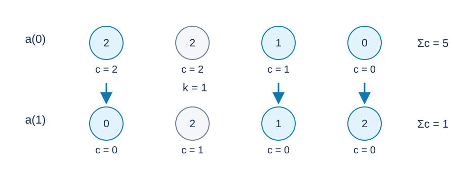

# 选择后缀元素的排序：题解

**出题人解法：维护活跃位置的逆序贡献，配合两层线段树。GPT-6 补充不变量证明、无效选点的边界处理和标准 C++17 实现。**

## 1. 每个位置的贡献

令 $c_i$ 为当前位于 $i$ 的数与其右方构成的逆序对数，答案为 $\sum_i c_i$ .称 $c_i>0$ 的位置为活跃位置。

一次排序后，每个被选位置都成为后缀最小值：其右方选中位置上的数不小于它，而未选中的后继数都不小于操作的原枢轴值。因此这些位置的贡献变为零。

已经成为后缀最小值的位置以后也不会重新活跃：

- 操作起点在其右边时，只重排其后缀的多重集合。
- 它再次被选中时，仍由上述性质成为后缀最小值。
- 操作起点在它左边而它未选中时，它的值至少是枢轴值。其后不可能还有严格小于枢轴的数，否则违反它是后缀最小值；因而没有选中值被搬到它后面。

所以每个位置至多失活一次，活跃位置上的值始终等于该位置的初始值。可以保存初始值而不真的重排数组。

## 2. 一次操作的精确更新

若 $c_k=0$ ，位置 $k$ 已是后缀最小值，选中集合只有它自己，直接跳过。否则设它的初始值为 $P$ ：

1. 将位置 $k$ ，以及所有 $i>k$ 且初始值小于 $P$ 的活跃位置清零。
2. 所有 $i>k$ 、初始值等于 $P$ 的剩余活跃位置，贡献减一。
3. 其余贡献不变。

第一步来自选中位置变为后缀最小值。对一个未选的活跃后继位置：值大于 $P$ 时，所有选中值都比它小，位于其右方的选中槽位数量未变；值等于 $P$ 时，操作把唯一一个等于 $P$ 的选中值从位置 $k$ 移到了最后一个选中槽位。该活跃位置后方原本有更小值，因此最后一个选中槽位在它后方，恰好少一个逆序对。位于 $k$ 左方的位置看到的后缀多重集合没有改变。

在样例二中，第一次操作后只有位置 $2$ 的贡献为一。再次选择位置 $1$ 必须跳过；不能再按它的初始值 $2$ 更新其他位置。

## 3. 两层线段树

离散化初始数值，用树状数组从右向左求初始 $c_i$ .

全局线段树按位置建立，维护区间内活跃位置的最小初始值；无活跃位置时取正无穷。清除后缀中初始值小于 $P$ 的位置时，最小值不小于 $P$ 的整段可以跳过。

每种初始值再按原位置顺序建一棵线段树，维护：

- 正贡献的最小值，零贡献视为正无穷；
- 活跃位置数；
- 对所有活跃贡献统一减去的懒标记。

删除单点前先下传它所在组的标记，取出真实贡献并从总答案中扣除。对同值组的后缀减一时，整段最小值大于一即可懒更新，并从答案扣除活跃数；最小值为一时向下找到变零的叶子，同时从全局树中删去该位置。无活跃位置的节点忽略懒标记。

## 4. 正确性与复杂度

初始树状数组给出精确贡献。第二节证明一次更新恰好实现数组排序对每个贡献的影响，且失活位置不会重新活跃。因此归纳可得全部输出正确，负指令也始终使用正确的上一次答案。

每次普通范围边界至多访问对数层。额外向下清除或寻找零贡献的访问可计入被永久删除的位置；每个位置至多删除一次，每次涉及两棵树的对数次操作。总时间为 $O((n+m)\log n)$ ，空间为 $O(n)$ ，所有值组的节点数合计为线性规模。

答案可达 $n(n-1)/2$ ，使用有符号 64 位整数。负数取模须调整到 $0,\ldots,n-1$ .直接重排数组会重复访问大量已失活位置，不适合完整范围。

[参考程序](std.cpp)。

## 图示

图中 $a(0),a(1)$ 是第一次排序前后的数组，圆内为数值，圆下的 $c$ 为该位置向右的逆序贡献。蓝色位置属于选中集合；贡献和由五变一。

## 数据与复现

三个样例见题面。[生成配方](tests/plan.json)包含十份计分输入；[生成器](tests/generate.py)只依赖 Python 标准库，支持 --plan、--out-dir、--case 和 --std。正式大输入及可执行文件不放入发布包。时间和内存的参考测量见[性能记录](../../../docs/benchmark-R29.json)。
