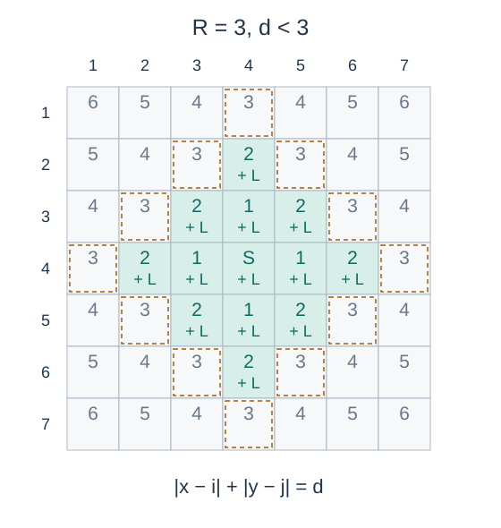

# 插火把

- 参考时间限制：1.0 秒（参考环境：[评测环境与性能](../../../docs/评测环境与性能.md)；仅供预估）
- 实际时间限制：标准程序在目标评测环境中处理最慢正式测试文件的基准时间的 2 倍，按 0.5 秒的倍数向上取整；若平台仅支持更粗的粒度，再向上取整到平台可设置值。
- 内存限制：128 MB

## 背景故事

村长刚开辟了一片农田，希望用火把照亮它，防止怪物出现。农田中也存在会降低亮度的黑暗源。每个光源的作用范围有限，请计算最终仍有可能出现怪物的方格数量。

## 形式化问题描述

农田是 $n$ 行 $m$ 列的网格，行列均从 $1$ 开始编号。每个位置 $(i,j)$ 有发光值 $L_{i,j}$ 、半径 $R_{i,j}$ 和刷怪阈值 $D_{i,j}$ ，初始亮度为零。

位置 $(i,j)$ 会向每个满足

$$|x-i|+|y-j|<R_{i,j}$$

的农田方格 $(x,y)$ 增加 $L_{i,j}$ 的亮度。所有位置的贡献叠加，负发光值表示降低亮度。半径为零时不影响任何方格；农田外的位置忽略。

若某格最终亮度小于或等于该格的 $D_{i,j}$ ，该格就有可能刷怪。求这样的方格总数。



图 1：以标记为 $S$ 的格子为中心，$R=3$ 时仅标有 $+$ 的格子增加亮度；数字表示到光源的曼哈顿距离。

## 输入格式

第一行两个整数 $n,m$ .接下来 $n$ 行，第 $i$ 行包含 $m$ 对整数 $L_{i,j},R_{i,j}$ ，依列号递增给出。最后 $n$ 行，每行 $m$ 个整数，表示各格的 $D_{i,j}$ .

## 输出格式

输出一个整数，表示最终有可能刷怪的方格数量。

## 样例 1

### 输入

```text
7 5
0 0 0 0 0 0 0 0 0 0
0 0 0 0 0 0 0 0 0 0
0 0 0 0 1 3 0 0 0 0
0 0 0 0 0 0 0 0 0 0
0 0 0 0 0 0 0 0 0 0
0 0 0 0 0 0 0 0 0 0
0 0 0 0 0 0 0 0 1 1
0 0 0 0 0
0 0 0 0 0
0 0 0 0 0
0 0 0 0 0
0 0 0 0 0
0 0 0 0 0
0 0 0 0 0
```

### 输出

```text
21
```

### 解释

位置 $(3,3)$ 的光源照亮 $13$ 格，位置 $(7,5)$ 的光源只照亮自身，两部分不重叠。共有 $35-14=21$ 格亮度为零，可以刷怪。

## 样例 2

### 输入

```text
1 3
10 1 -3 2 8 0
7 -3 -3
```

### 输出

```text
3
```

### 解释

最终三格亮度依次为 $7,-3,-3$ ，均恰好等于对应阈值，因此三格都计入答案。半径为零的光源不贡献亮度。

## 数据范围与保证

- $1\le n,m\le2200$ .
- $0\le R_{i,j}\le100000$ ，$|L_{i,j}|\le10^8$ ，$|D_{i,j}|\le10^{15}$ .

### 数据分组

| 分值比例 | 额外条件 |
| --- | --- |
| 30% | $n,m\le80$ |
| 20% | $n,m\le300$ |
| 30% | $n,m\le1500$ |
| 20% | 无额外条件 |
