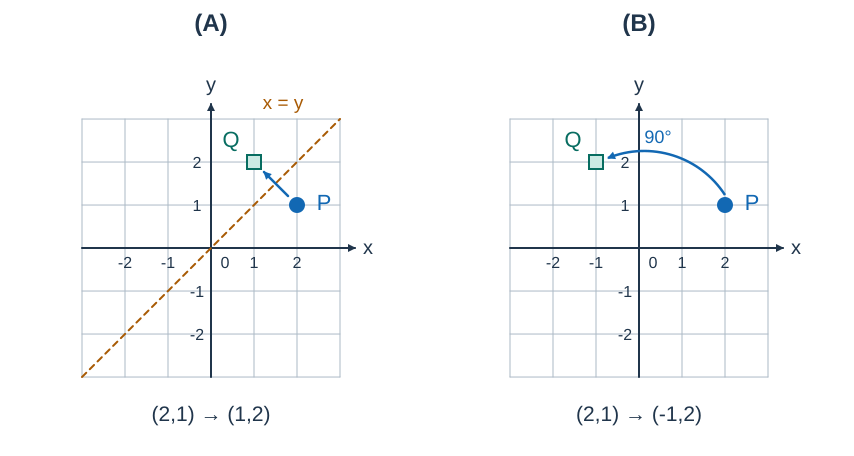

# 真空内爆弹

- 参考时间限制：**1.0 秒**（[评测环境与性能](../../../docs/评测环境与性能.md)）。
- 实际时间限制：标准程序在目标评测环境中处理最慢正式测试文件的基准时间的 2 倍，按 0.5 秒的倍数向上取整；若平台仅支持更粗的粒度，再向上取整到平台可设置值。
- 内存限制：128 MB

## 背景故事

作战实验室正在模拟真空内爆弹对载具位置的影响。为了反复测试不同方案，研究员给载具编号，批量平移、翻转或旋转一段编号内的载具，并随时查询坐标。请维护整个模拟过程。

## 形式化问题描述

平面上有 $n$ 个点，按 $1$ 到 $n$ 编号，初始坐标为 $(x_i,y_i)$ .按输入顺序处理 $m$ 个操作。编号不随位置改变；区间 $[l,r]$ 指编号区间，两端都包含。

- `0 l r a` ：将这些点从 $(x,y)$ 变为 $(x+a,y)$ .
- `1 l r a` ：变为 $(x,y+a)$ .
- `2 l r` ：关于 $x$ 轴对称，变为 $(x,-y)$ .
- `3 l r` ：关于 $y$ 轴对称，变为 $(-x,y)$ .
- `4 l r` ：关于直线 $x=y$ 对称，变为 $(y,x)$ .
- `5 l r` ：关于直线 $x=-y$ 对称，变为 $(-y,-x)$ .
- `6 l r b` ：绕原点逆时针旋转 $b$ 度。
- `7 i` ：查询第 $i$ 个点的当前坐标。

旋转采用通常的直角坐标系，$x$ 轴向右，$y$ 轴向上。令 $\theta=b\pi/180$ ，则旋转结果为

$$\bigl(x\cos\theta-y\sin\theta,\ x\sin\theta+y\cos\theta\bigr)$$



图 1：两幅图独立地从 $P=(2,1)$ 出发。A 图执行操作 `4` ，B 图执行角度为 $90$ 的操作 `6` ；圆点 P 是操作前的位置，方点 Q 是操作后的位置。

先输出各次查询的结果，全部操作结束后，再按编号顺序输出所有点的最终坐标。

## 输入格式

第一行两个整数 $n,m$ .接下来 $n$ 行，每行给出初始整数坐标 $x_i,y_i$ .之后 $m$ 行，按上述格式描述操作。

## 输出格式

每次 `7` 操作输出一行两个实数。全部操作结束后，再输出 $n$ 行，每行两个实数，表示对应点的最终坐标。

每个坐标的绝对误差不超过 $0.05$ 即可。输出行数为查询次数加 $n$ ，不是操作次数加 $n$ .

## 样例 1

### 输入

```text
10 30
1470 7211
4180 -960
-2962 -5944
-9984 -6050
-6674 6625
-1462 -6774
-1042 -4576
-2533 1499
9729 5985
4800 179
5 4 10
2 6 10
4 5 6
5 4 9
5 4 8
0 3 4 63
5 1 1
6 2 6 99
0 4 8 35
4 6 10
5 1 2
7 7
4 3 5
4 1 7
0 9 10 87
1 5 10 -47
2 3 4
5 4 8
5 9 10
0 10 10 40
7 5
3 5 7
6 7 8 19
5 5 8
7 3
6 6 9 17
0 6 9 -38
3 3 6
2 1 10
6 3 7 46
```

### 输出

```text
-1042.00 4611.00
-7581.21 -5534.39
6324.32 1933.46
7211.00 -1470.00
-294.28 4278.71
-3002.43 -5892.43
4646.96 -10709.75
-9297.98 1285.24
5216.82 4595.75
3868.25 2670.62
-2622.19 1421.68
11086.12 2948.46
266.00 4887.00
```

### 解释

前三行依次回答三个查询，后十行给出全部点的最终坐标。

## 样例 2

### 输入

```text
2 6
2 1
-1 0
7 1
4 1 1
6 1 2 90
0 1 2 3
5 2 2
7 2
```

### 输出

```text
2.00 1.00
1.00 -3.00
1.00 1.00
1.00 -3.00
```

### 解释

第一个点依次变为 $(1,2)$ 、$(-2,1)$ 、$(1,1)$ .第二个点最终为 $(1,-3)$ .

## 数据范围与保证

- $1\le n,m\le50000$ .
- 初始坐标满足 $\lvert x_i\rvert,\lvert y_i\rvert\le10000$ .
- $1\le l\le r\le n$ ，$1\le i\le n$ ，$-100\le a\le100$ ，$0\le b\le360$ .
- 所有输入量均为整数；允许没有查询，仍须输出全部最终坐标。

### 数据分组

| 分值比例 | 额外条件 |
| --- | --- |
| 100% | 无额外条件 |
