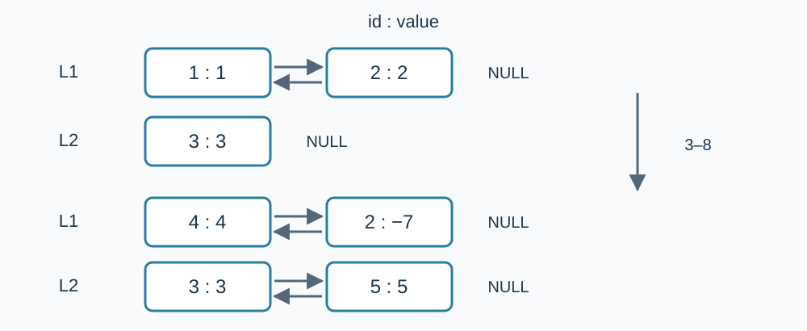

# Variable Lists

Estimated time limit: 0.5 seconds. Memory limit: 128 MB.

The deployed limit is twice the largest per-input median runtime of the reference program on the target judge, rounded up to a multiple of $0.5$ seconds. See the [reference measurements](../../../docs/评测环境与性能.md).

## Story

A visual editor keeps a separate list of local variables for each subroutine. Programmers insert and delete variables and edit their notes. Maintain the lists and answer queries about a variable and its neighbors.

## Formal Problem Statement

There are $n$ lists. List $i$ initially contains $c_i$ variables. Assign consecutive IDs $1,2,\ldots,C$ by increasing list number and then from front to back within each list, where $C=\sum_{i=1}^n c_i$ . Each variable's initial note equals its ID.

Support these operations:

| Operation | Meaning |
| --- | --- |
| `1 id` | Query the notes of the predecessor, the variable itself and the successor, within its own list. Print `NULL` for a missing predecessor or successor. If the variable does not exist or was deleted, print three `NULL` entries. |
| `2 id` | Delete the variable. Ignore an unassigned ID or an already deleted variable. |
| `3 nid` | Insert a variable at the front of list `nid` . |
| `4 nid` | Insert a variable at the back of list `nid` . |
| `5 id x` | Change the variable's note to `x` . Ignore an unassigned ID or an already deleted variable. |

Every insertion receives a fresh ID equal to the initial number of variables plus the number of insertions so far, including this insertion. Its initial note equals that ID. Deletion never reuses an ID. A list may become empty; inserting at either end of an empty list creates a one-element list. Editing a note does not change the ID.



Node labels are “ID: note”, and arrows indicate neighboring variables within a list. The upper pair shows the initial state of Sample 1; the lower pair shows the state after operation $8$ .

## Input

The first line contains $n$ . The second line contains $n$ integers $c_1,\ldots,c_n$ . The third line contains the number of operations $m$ . Each of the next $m$ lines describes one operation in the format above.

## Output

Only `1 id` operations produce output. Print three entries for the predecessor, the variable itself and the successor, using the note or `NULL` as appropriate. Separate entries with one space.

## Samples

### Sample 1

### Input

```text
2
2 1
12
1 2
1 3
5 2 -7
1 1
2 1
1 2
3 1
4 2
1 4
1 5
2 2
1 2
```

### Output

```text
1 2 NULL
NULL 3 NULL
NULL 1 -7
NULL -7 NULL
NULL 4 -7
3 5 NULL
NULL NULL NULL
```

### Sample 2

### Input

```text
1
1
9
2 1
1 1
1 2
3 1
1 2
2 2
4 1
1 3
1 0
```

### Output

```text
NULL NULL NULL
NULL NULL NULL
NULL 2 NULL
NULL 3 NULL
NULL NULL NULL
```

### Sample 3

### Input

```text
1
2
5
5 1 42
5 2 42
1 1
2 1000000000
1 2
```

### Output

```text
NULL 42 42
42 42 NULL
```

## Sample explanations

In Sample 1, after ID $2$ is changed to note $-7$ , querying ID $1$ reports the updated successor note. Once ID $1$ is deleted, ID $2$ has no predecessor. Sample 2 demonstrates that IDs are never reused. In Sample 3, two variables may have the same note while retaining distinct IDs.

## Constraints and guarantees

For all inputs: $1\le n\le500$ , $1\le c_i\le1000$ , and $1\le m\le5\times10^5$ . Insertions satisfy $1\le\mathrm{nid}\le n$ ; IDs and notes in the other operations satisfy $|\mathrm{id}|,|x|\le10^9$ . Every operation has one of the five listed types.

| Score | Additional conditions |
| --- | --- |
| 100% | No additional conditions |
