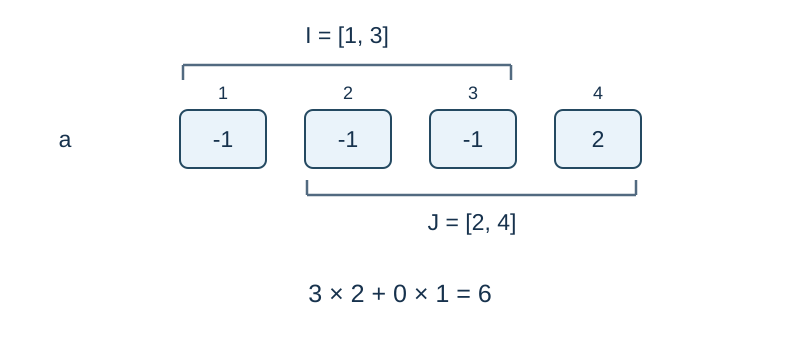

# You Wrote This Problem Yourself

Time limit: 1.5 seconds. Memory limit: 128 MiB. See the [reference environment and measurements](../../../docs/评测环境与性能.md).

## Story

You wrote this problem yourself, yet now you have no idea how to solve it.

## Formal Problem Statement

Given an integer sequence $a$ of length $n$ , process $m$ operations in order. Decoded operations are:

- `1 x v` : set $a_x=v$ .
- `2 l_1 r_1 l_2 r_2` : count ordered pairs $(x,y)$ with $l_1\le x\le r_1$ , $l_2\le y\le r_2$ , and $a_x=a_y$ . The ranges may overlap, $x=y$ is allowed, and the two orientations count separately.

Let `last` be the latest query answer, initially zero. Updates do not change it. **Every integer on an operation line, including the operation type**, is encoded as follows: replace the actual integer $z$ by its nonnegative residue modulo $2^{64}$ , XOR that 64-bit value with `last` , and print the result as an unsigned decimal integer.

After XOR decoding, types and indices are nonnegative integers. For an update value, use the decoded value unchanged if it is below $2^{63}$ ; otherwise subtract $2^{64}$ to obtain its negative value. The first two lines, containing $n,m$ and the initial sequence, are not encoded. All decoded operations are guaranteed valid.

## Input Format

The first line contains unencoded `n m` . The second contains $n$ unencoded signed integers $a_i$ . The next $m$ lines are encoded operations; decode the type first to determine whether two or four arguments follow. Encoded fields lie in $[0,2^{64}-1]$ .

## Output Format

For each query, print its unencoded answer on one line. Answers can reach $n^2$ ; use 64-bit integers.

## Sample 1

### Input

```text
4 4
-1 2 -1 2
2 1 4 1 4
9 10 18446744073709551607
10 9 11 10 12
4 4 4 4 4
```

### Output

```text
8
6
1
```

## Sample 2

### Input

```text
1 3
1000000000
2 1 1 1 1
0 0 18446744072709551617
3 0 0 0 0
```

### Output

```text
1
1
```

## Sample Explanation

The decoded operations in Sample 1 are `(2,1,4,1,4)` , `(1,2,-1)` , `(2,1,3,2,4)` , and `(2,2,2,2,2)` . The first answer is 8, the range query after the update gives 6, and pairing a singleton with itself gives 1.



The ranges may overlap. For each value, multiply its frequencies in the two ranges, then sum.

## Constraints and Scoring

$1\le n\le10^5$ , $1\le m\le10^4$ , $|a_i|,|v|\le10^9$ , $1\le x\le n$ , and $1\le l_j\le r_j\le n$ . These bounds refer to decoded values.

Specifications redesigned by Codex (GPT-6): the initial-array input, encryption of every operation field, 64-bit signed-value encoding, and fixed bounds.

| Score | Additional constraints |
| --- | --- |
| 20% | $n\le50,\ m\le100$ |
| 30% | $n,m\le2000$ |
| 50% | No additional constraints |
