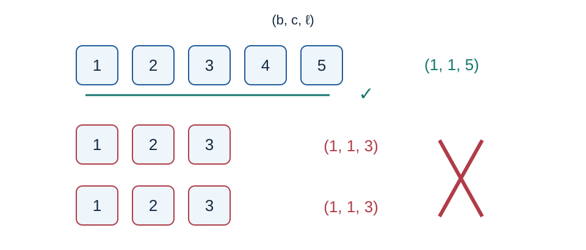

# 不同顺子的牌组划分：题解

贡献：Codex（GPT-6）完成本题的有限状态建模、正确性证明、按位并行转移与标准 C++17 实现。有限状态动态规划是经典方法。

## 同种同数字先合并

把领取记录按“种类、数字”排序，相同键的数量相加。不同种类的牌不会进入同一组，可以分别处理。记录数量总和可能达到 $5\times10^{15}$ ，聚合计数与排序键使用六十四位整数。

只使用同牌三张、四张组时，一个数量 $c$ 可行，当且仅当 $c\ge0$ 且 $c\notin\{1,2,5\}$ .零、三、四显然可行；六、七、八分别为三加三、三加四、四加四。任意更大的整数可反复减三归入这三种情况；一、二、五无法组成。

## 六个比特记住尚未完成的顺子

固定一种牌，从小到大处理数字。每个起点的三张顺子与五张顺子各最多一个。处理数字 $i$ 前，只需要记住：

- 起点为 $i-1,i-2$ 的三张顺子是否存在；
- 起点为 $i-1,i-2,i-3,i-4$ 的五张顺子是否存在。

共六个布尔量，构成 $64$ 个状态。令状态 $s$ 的一比特个数为 $h(s)$ ，它就是已经开始的顺子在当前数字上必须拿走的牌数。

在当前数字再选择是否开始三张、五张顺子，分别记为 $u,v\in\{0,1\}$ .若当前数量为 $c$ ，则剩余

$$c-h(s)-u-v$$

必须满足同牌组条件。随后将两段历史分别左移，加入 $u,v$ ，丢弃已经完成顺子的最老比特。编码采用高两位存三张顺子、低四位存五张顺子：

$$s'=16\bigl((2\lfloor s/16\rfloor+u)\bmod4\bigr)+\bigl(2(s\bmod16)+v\bigr)\bmod16.$$

初态只有空状态零。处理完某种牌后，必须存在状态零，否则仍欠未来数字的牌。两个实际出现的数字之间若有缺口，缺失数字的数量为零，所有开放顺子都无法跨过它。因此在缺口处检查空状态并重置，无需扫描大量不存在的数字。种类变化时同样检查。

图中的三元组 $(b,c,\ell)$ 依次表示种类、起始数字、长度。五个不同数字可组成一个五张顺子；下面两个相同的三张顺子不能同时使用。

## 将整个可行状态集放入一个整数

用无符号六十四位整数的第 $s$ 位表示状态 $s$ 是否可行。当前所需牌数最多为 $6+2=8$ ，故 $c\ge14$ 时剩余至少六张，所有余量均可行。只需处理数量类别 $0,\ldots,14$ ，大于十四的数量按十四处理。

预计算掩码 $H[c][t]$ ，保留满足 $c-h(s)-t$ 可分组的状态，其中 $t=u+v\in\{0,1,2\}$ .令 $P(X)$ 表示不加入新顺子时的历史移动，并把移动后相同的状态合并。那么

$$X'=P(X\mathbin{\&}H[c][0])\mathbin{|}\bigl(P(X\mathbin{\&}H[c][1])\ll1\bigr)\mathbin{|}\bigl(P(X\mathbin{\&}H[c][1])\ll16\bigr)\mathbin{|}\bigl(P(X\mathbin{\&}H[c][2])\ll17\bigr).$$

位或表示可行状态的并集。移动 $P$ 需要遗忘状态编号的第三、第五比特：依次把集合与其右移八位、右移三十二位的结果取或，再取位置零到七与十六到二十三两个八位片段。用一个 $256$ 项表把片段第 $j$ 位展开到第 $2j$ 位，高片段再左移三十二位。新顺子对应的两个位置留空，最后用上式填入。所有移位作用于无符号数，最大结果位号为六十三。

## 正确性

归纳地，可行状态集恰好描述当前数字以前的所有合法分组及其未完成顺子。任何合法划分在当前数字都唯一确定已经欠下的数量及新开顺子 $u,v$ ；其余牌必须且只需分成同牌组，因此不会漏掉合法转移。反过来，每个转移都为开放顺子补足一张，并使用互不重复的起点、长度标记，新状态准确记住剩余需求。终点空状态恰好等价于所有顺子已经结束。各类型互不相交，所以逐类型均可行当且仅当全部牌可划分。按位实现只合并相同目标状态，不改变这一递推。

## 复杂度与方案选择

令 $d\le k$ 为合并后的不同牌键数。排序耗时 $O(k\log k)$ ，动态规划耗时 $O(d)$ ，总空间 $O(k)$ .五百万个十六字节记录约占八千万字节，排序原地进行；不要再保留同等大小的副本。

直接遍历六十四个状态也是同一递推，可用于核对；按位版本避免每个数字逐状态枚举。额外引入矩阵或一般图搜索没有时间、空间或表达上的优势。

参考程序：[std.cpp](std.cpp)。验证包含独立枚举顺子子集、全部单状态转移核对和最大范围直接状态递推。正式数据配方见 [plan.json](tests/plan.json)，生成方法见 [generate.py](tests/generate.py)，运行记录见[性能数据](../../../docs/benchmark-R26.json)。
