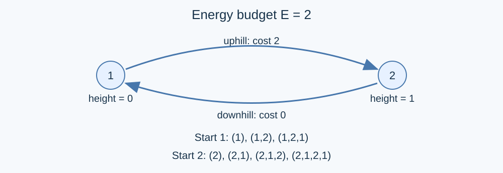

# Routes with Limited Energy: Order States by Energy and Height

## Identify what is being counted

Only vertex sequences distinguish routes. Normalize each undirected edge by sorting its endpoints, then remove duplicate endpoint pairs. Add both directions for an ordinary edge, but only one neighbor entry for a self-loop. Since heights are integers, the cost is exactly zero downhill, one at equal height and two uphill.

The graph may contain cycles, but zero-cost moves strictly decrease height and cannot cycle. There are at most $E$ positive-cost moves in a legal route. Each intervening descending segment is finite as well, so the total number of routes is finite.

## States by available energy

Let $F_e(u)$ count routes starting at $u$ with total cost at most $e$ . Stopping immediately contributes one. Classify every other route by its first next vertex:

$$F_e(u)=1+\sum_{h_v<h_u}F_e(v)+\sum_{h_v=h_u}F_{e-1}(v)+\sum_{h_v>h_u}F_{e-2}(v).$$

Each sum ranges over distinct neighbors. Terms with negative energy indices are zero, and all arithmetic is modulo $998244353$ .

Process $e=0,1,\ldots,E$ . Within one layer, process vertices in increasing height order. Same-layer dependencies have strictly smaller height and are already known. Equal-height and uphill moves use one or two earlier layers. Three rolling arrays suffice.

## Correctness

Every route in a state either stops immediately or makes its first move to a feasible neighbor. These classes have different vertex sequences. Removing the first move leaves exactly a route counted by the corresponding remaining-energy state; adding that move back always gives a legal route.

Induction first on energy and then on height proves the recurrence, because every dependency is processed earlier. Different starting vertices give different sequences, so the answer is $\sum_uF_E(u)$ . With $E=0$ , descending routes still count: the answer is not necessarily just the number of vertices. If $n=0$ , the answer is zero.

## Implementation, complexity and contribution

Equal-height vertices may be processed in any order. A self-loop costs one and refers to an earlier layer. When reusing a rolling array, every current-layer entry is assigned afresh, while the preceding two layers remain available. Reduce after every addition; two residues sum to less than $2^{31}$ .

Sorting costs $O(n\log(n+1)+m\log(m+1))$ time, the DP costs $O((E+1)(n+m))$ , and space is $O(n+m)$ . The reference [std.cpp](std.cpp) supports the full constraints. Forward propagation by exact energy spent and ending vertex is another direction on the same acyclic state graph and is used for independent validation. Keeping all energy layers does not improve this problem's time or space needs, so no separate published program is listed for it.

The supplied materials contain no usable solver or solution explanation. GPT-6 applies classical layered DP and provides the model, proof, bilingual explanation and C++17 implementation; layered DP itself is a general technique. Tests cover zero energy, empty graphs, parallel edges, self-loops, equal-height cycles, descending chains and maximum energy. See the [measurements](../../../docs/benchmark-R25.json).
