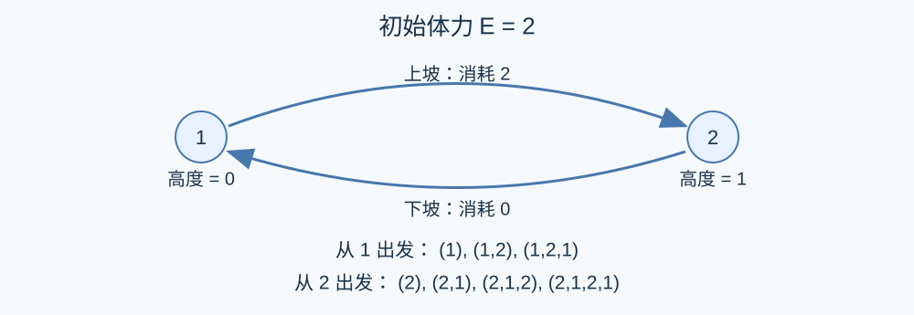

# 有限体力的路线计数

预估时间限制：0.5 秒。内存限制：128 MB。

实际时限以标准程序在目标环境的最慢用例中位时间乘以 $2$ ，按 $0.5$ 秒向上取整。参考环境见[评测说明](../../../docs/评测环境与性能.md)。

## 背景故事

勘察机器人要沿山地道路移动。下坡无需消耗体力，平路和上坡会消耗体力。给定一次出发时的体力，统计它可以走出的路线。

(本故事由GPT-6重写)

## 形式化问题描述

有 $n$ 个编号为 $1,\ldots,n$ 的顶点，第 $i$ 个高度为整数 $h_i$ .有 $m$ 条无向道路，第 $i$ 条连接 $u_i,v_i$ .每次移动必须使用恰好一条道路。

从顶点 $u$ 移动到顶点 $v$ 的消耗为

$$c(u,v)=\begin{cases}0,&h_v<h_u,\\1,&h_v=h_u,\\2,&h_v>h_u.\end{cases}$$

可以从任意顶点出发，初始体力为 $E$ ，路线的总消耗不能超过 $E$ .可以任意时刻结束，包括不移动；允许重复经过顶点和道路。

路线表示为“起点，第一次移动后所在顶点，第二次移动后所在顶点，……”的顶点序列。只有顶点序列不同才视为不同路线：平行道路不增加同一顶点序列的计数；通过自环移动一次会重复写入当前顶点，消耗一单位体力。

求路线数对 $998244353$ 取模的非负最小剩余。$n=0$ 时没有路线。

## 输入格式

第一行三个整数 $n,m,E$ .第二行 $n$ 个整数 $h_1,\ldots,h_n$ .随后 $m$ 行，每行两个整数 $u_i,v_i$ .$n=0$ 时高度一行为空，且 $m=0$ .

## 输出格式

输出一行一个整数，表示取模后的路线数。

## 样例

### 样例 1

### 输入

```text
2 1 2
0 1
1 2
```

### 输出

```text
7
```

### 样例 2

### 输入

```text
2 3 1
0 0
1 2
1 2
1 1
```

### 输出

```text
5
```

### 样例 3

### 输入

```text
0 0 30
```

### 输出

```text
0
```

## 样例解释

第一组从顶点一出发的路线是 $(1)$ 、$(1,2)$ 、$(1,2,1)$ ；从顶点二出发有 $(2)$ 、$(2,1)$ 、$(2,1,2)$ 、$(2,1,2,1)$ .第二组有 $(1)$ 、$(2)$ 、$(1,2)$ 、$(2,1)$ 、$(1,1)$ 五种顶点序列，重复的道路不会增加数量。第三组没有路线。



## 数据范围与保证

$0\le n,m\le10^5$ , $-10^5\le h_i\le10^5$ , $0\le E\le30$ , $1\le u_i,v_i\le n$ .

| 分值比例 | 额外条件 |
| --- | --- |
| 100% | 无额外条件 |
