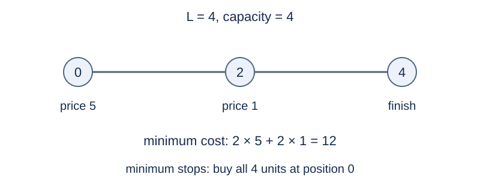

# Journey with Limited Fuel Supplies

## Story

A delivery vehicle travels along a line toward its destination. Each fuel station has a price and limited stock. Its dispatcher separately wants the cheapest plan and the plan requiring the fewest refueling stops.

(This story was rewritten by GPT-6.)

## Formal Problem Statement

Start at position $0$ with an empty tank and move only forward to integer position $L$ . Traveling one distance unit consumes one fuel unit. Tank capacity is $R$ ; input $R=-1$ means unlimited capacity.

There are $N$ stations. Station $i$ is at $x_i$ , sells fuel at price $c_i$ per unit, and has total stock $s_i$ . Positions are distinct, and input order is arbitrary. Purchases must be integer quantities and cannot exceed the station stock or tank capacity. Buying a positive quantity at a station counts as one refueling stop; buying zero does not. Fuel may remain at the destination.

Find the minimum total cost and the minimum number of refueling stops over all feasible plans. These are independent objectives; one plan need not attain both. If the destination is unreachable, both answers are $-1$ .

## Input Format

The first line is `N L R` . Each of the next $N$ lines contains `x_i c_i s_i` .

## Output Format

Print the minimum cost on the first line and the minimum stop count on the second. Print −1 on both lines if unreachable.

## Sample 1

### Input

```text
2 4 4
0 5 4
2 1 4
```

### Output

```text
12
1
```

## Sample 2

### Input

```text
1 5 2
0 3 5
```

### Output

```text
-1
-1
```

## Sample 3

### Input

```text
3 4 2
2 0 2
0 5 1
1 2 2
```

### Output

```text
7
3
```

## Sample Explanation

In sample 1, minimum cost 12 is attained by buying two units at each station. The minimum stop count is one, achieved by buying four units at the start. In sample 2, the tank cannot cover five units without another station. Sample 3 gives stations out of order; minimum cost is 7 and all three stations must be used.



Different plans attain the two objectives in sample 1.

## Constraints and Scoring

$1\le L\le2000$ , $0\le N\le L$ , and either $R=-1$ or $1\le R\le L$ ; $0\le x_i<L$ and $0\le c_i,s_i\le10^9$ .

Specifications redesigned by Codex (GPT-6): input/output, integer fuel, station bounds, the initially empty tank, and the two independent objectives.

| Score | Additional constraints |
| --- | --- |
| 20% | $L\le12$ |
| 30% | $L\le200$ |
| 50% | No additional constraints |

## Resource Limits

Time: 1 seconds. Memory: 128 MiB.

The limit is 16 times the slowest standard-program median across five runs per formal input, rounded up to 0.5 seconds. The larger multiplier accommodates the alternative algorithm with a different use case.

[Measurement environment](../../../docs/评测环境与性能.md) · [Measurements](../../../docs/benchmark-R32.json) · [Solution](solution.en.md)
