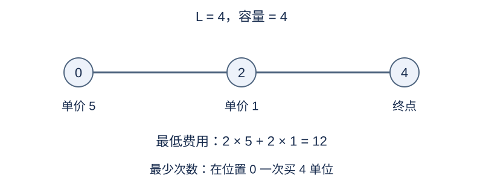

# 限量补给的旅程

## 背景故事

一辆运输车沿直线驶向目的地，途中补给站各有单价和有限库存。调度员分别关心最省钱的计划和停车加油次数最少的计划。

(本故事由GPT-6重写)

## 形式化问题描述

从位置 $0$ 出发，初始油箱为空，只能向前行驶到整数位置 $L$ .每前进一单位距离消耗一单位燃料。油箱容量为 $R$ ；若输入 $R=-1$ ，容量不受限制。

有 $N$ 个站点，站点 $i$ 位于 $x_i$ ，每单位燃料价格为 $c_i$ ，总库存为 $s_i$ .站点位置各不相同，输入次序任意。只能在站点购买整数单位的燃料，不能超过该站库存或油箱容量。在一个站点购买正数单位算一次加油，购买零单位不计次数。可以有剩余燃料到达终点。

分别求所有可行计划中的最低总费用和最少加油次数。这是两个独立目标，不要求同一计划同时取得二者。若无法到达，两个答案均为 $-1$ .

## 输入格式

第一行 `N L R` .接下来 $N$ 行，每行 `x_i c_i s_i` .

## 输出格式

第一行输出最低费用，第二行输出最少加油次数；不可达时两行均输出 −1。

## 样例 1

### 输入

```text
2 4 4
0 5 4
2 1 4
```

### 输出

```text
12
1
```

## 样例 2

### 输入

```text
1 5 2
0 3 5
```

### 输出

```text
-1
-1
```

## 样例 3

### 输入

```text
3 4 2
2 0 2
0 5 1
1 2 2
```

### 输出

```text
7
3
```

## 样例说明

样例 1 最低费用为 12，需要分两站各买 2 单位；最少加油次数为 1，可在起点一次买 4 单位。样例 2 的油箱无法支持无补给的五单位路程。样例 3 的站点输入无序，最低费用为 7，三站都必须加油。



样例 1 的两个目标由不同计划取得。

## 数据范围与分组

$1\le L\le2000$ ，$0\le N\le L$ ，$R=-1$ 或 $1\le R\le L$ ；$0\le x_i<L$ ，$0\le c_i,s_i\le10^9$ .

规格由 Codex（GPT-6）重新设计：补齐输入输出、整数燃料与站点范围，明确初始空箱和两个独立优化目标。

| 分值 | 额外限制 |
| --- | --- |
| 20% | $L\le12$ |
| 30% | $L\le200$ |
| 50% | 无额外限制 |

## 资源限制

时间 1 秒；内存 128 MiB。

时限取标准程序正式数据五次运行的最慢中位数的 16 倍，向上取整到 0.5 秒。采用较大倍数，以容纳具有不同用途的补充算法。

[测量环境与方法](../../../docs/评测环境与性能.md) · [测量记录](../../../docs/benchmark-R32.json) · [题解](solution.zh.md)
