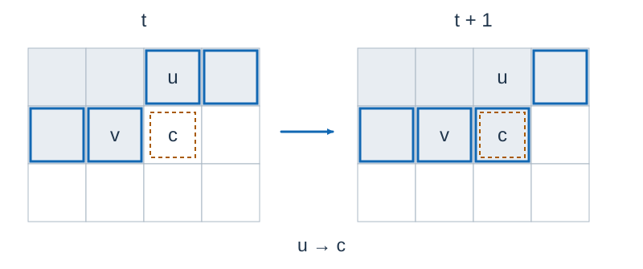

# Melon Planting 3: Solution

**Solution design and implementation for this problem: Codex (GPT-6).** This solution adapts the established three-state path-decomposition method for minimum maximal matching into cell-by-cell frontier transitions. Time is $O(nm\,3^w)$ , where $w=\min(n,m)$ .

For the underlying three-state path-decomposition dynamic program, see van Rooij and Bodlaender, [Exact Algorithms for Edge Domination](https://www.researchgate.net/publication/220992947_Exact_Algorithms_for_Edge_Domination).

## Matching and the stopping condition

Add edges only between adjacent vines and initially empty cells. Obstacles and adjacent cells of the same type create no edge. Growth selects a matching, and stops exactly when every edge has at least one matched endpoint. We seek a maximal matching of minimum size.

The number of vines may be large, but the grid is narrow. Let $V=nm$ and $w=\min(n,m)$ . Transpose if necessary so that the number of columns is $w$ , then scan rows from top to bottom and cells from left to right.

## Keep only the frontier

Before processing cell $(x,y)$ , only some processed cells can still interact with future cells: cells to its left in the current row, and cells in the previous row that have not yet been replaced. Store one such cell in each of $w$ column slots.

The upper neighbor occupies slot $y$ , and the left neighbor occupies slot $y-1$ when $y>0$ . After processing the current cell, all edges incident to the upper neighbor have been processed. Forget that vertex and replace slot $y$ with the current cell. Older vertices need no state.

Shading marks processed cells, and thick outlines mark frontier cells. Here `u` is the upper neighbor, `v` the left neighbor, and `c` the current cell. The panels show the frontier before and after processing `c` ; actual cell types come from the input.

## Three states per vertex

Each frontier vertex uses a ternary digit:

| State | Meaning |
| --- | --- |
| $0$ | Committed to remaining unmatched in the final matching. |
| $1$ | Committed to being matched, but waiting for an unprocessed neighbor. |
| $2$ | Already matched and unable to select another matching edge. |

State $0$ is a final commitment. A vertex in state $1$ must acquire a partner before it leaves the frontier. Thus forbidding an edge with both endpoints in state $0$ ensures that the edge eventually has a matched endpoint. A waiting vertex must not be treated as permanently unmatched.

Let $dp[M]$ be the minimum number of selected matching edges for frontier encoding $M$ . Initially all slots are empty placeholders encoded as zero, and only $dp[0]=0$ . Actual edges are determined by coordinates and input characters, so placeholders and obstacle cells can use state $0$ without creating false edges.

## Four choices at each cell

Let $a$ be the upper neighbor's state and $b$ the left neighbor's state. An edge exists only between a vine and an empty cell.

1. **Leave the current vertex permanently unmatched.** Its new state is $0$ . Require $a\ne1$ , because the upper vertex is leaving. Each upper or left neighbor connected to the current cell must also have a state different from $0$ .
2. **Wait for a future partner.** Its new state is $1$ , again requiring $a\ne1$ . We can additionally require a legal edge below or to the right, since otherwise this promise can never be fulfilled.
3. **Match the upper neighbor.** Require an upper edge and $a=1$ . The current vertex becomes $2$ , the upper vertex fulfills its promise and leaves, and the cost increases by one.
4. **Match the left neighbor.** Require a left edge, $b=1$ , and $a\ne1$ . Both the current vertex and its left neighbor become $2$ , and the cost increases by one.

In the last two choices, the current vertex is matched, so any edge to the other old neighbor already satisfies the stopping condition. Already matched endpoints cannot be reused. Selecting only one choice per cell prevents simultaneous matches upward and leftward.

Use two rolling arrays. If $P_y=3^y$ , digit $y$ is $\lfloor M/P_y\rfloor\bmod3$ . Replacing this digit or changing the left neighbor from $1$ to $2$ takes a constant number of integer operations.

After scanning the whole grid, accept only encodings without state $1$ and take the minimum cost. Every promise in the last row must also be fulfilled; this final condition cannot be omitted.

## Correctness

Maintain the following invariant: each state represents a valid partial matching of the scanned region; forgotten vertices have fulfilled their final commitments; no processed edge joins two vertices committed to remaining unmatched; and the stored cost is the smallest selected-edge count satisfying these conditions.

The four choices partition the current vertex's role in any final matching: unmatched, partnered in the future, partnered above, or partnered to the left. Transitions prevent repeated use of endpoints, reject unfulfilled promises when a vertex leaves, and check all newly processed edges, preserving the invariant. Conversely, every valid final matching follows one of these choices at each cell, so none is missed.

At the end, no promise remains and the partial matching is complete. Every graph edge has a matched endpoint, making the matching maximal. All legal terminal states are represented, so the smallest cost is the required minimum harvest.

## Complexity and implementation

The frontier has $w$ ternary digits and each cell has at most four transitions. Time is $O(V3^w)$ . The two DP arrays use $O(3^w)$ space, while input and transposition use $O(V)$ , for total space $O(V+3^w)$ . Keep the width parameter $w$ in the complexity instead of substituting its numerical bound into the exponent.

Cells of the same type have no edge. The last cell of one row has no edge to the first cell of the next row, and the exterior creates no edges. The program checks actual coordinates for all of these conditions. A board with no vines, no empty land, or only obstacles naturally retains a zero-cost state.

## Verification and reproduction

The independent oracle enumerates all matchings and checks maximality on every three-character $2\times3$ board and on random boards. Medium instances are compared with the incremental algorithm and the original Melon Planting solution. Larger checks verify invariance under transposition, horizontal reflection, and swapping vine/empty types, as well as additivity of regions separated by a row of obstacles.

See [std.cpp](std.cpp), the [generation plan](tests/plan.json), and [environment and measurements](../../../docs/评测环境与性能.md) for the program, test cases and performance measurements.
