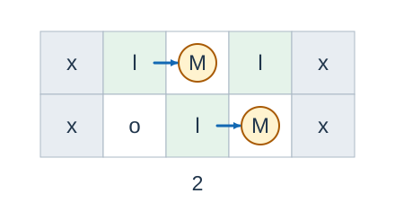

# 种西瓜 3

- 参考时间限制：0.5 秒（参考环境：[评测环境与性能](../../../docs/评测环境与性能.md)；仅供预估）
- 实际时间限制：标准程序在目标评测环境中处理最慢正式测试文件的基准时间的 2 倍，按 0.5 秒的倍数向上取整；若平台仅支持更粗的粒度，再向上取整到平台可设置值。
- 内存限制：128 MB

## 背景故事

沿着村边的小路，农夫开垦了一片狭长的瓜田。瓜藤会争用身边的空地，生长顺序和方向都无法控制。农夫想估计最差的收成：等整片瓜田再也长不出新瓜时，至少会有多少个瓜？

(本故事由GPT-6重写)

## 形式化问题描述

瓜田是 $n$ 行 $m$ 列的网格。每格初始为瓜藤 `l` 、空地 `o` 或障碍物 `x` ；网格外视为障碍物。瓜田较窄，满足 $\min(n,m)\le8$ ，瓜藤数量没有额外上限。

每株瓜藤至多结一个瓜。一次生长可以选择任意一株尚未结瓜、且上下左右至少有一格空地的瓜藤，在其中一格空地生成一个瓜。这个格子此后被占用，不能再长瓜。瓜藤所在格子始终是瓜藤，不能用来长瓜。

不断生长，直到没有瓜藤还能结瓜。求所有可能终止状态中的最小结瓜数。必须达到上述终止条件，不能在仍有生长机会时提前停止。

## 输入格式

第一行两个整数 $n,m$ .接下来 $n$ 行，每行一个长度为 $m$ 的字符串，表示瓜田。

## 输出格式

输出一个整数，表示终止时可能达到的最少结瓜数。

## 样例 1

### 输入

```text
2 5
xlolx
xolox
```

### 输出

```text
2
```

## 样例 2

### 输入

```text
1 6
lololo
```

### 输出

```text
2
```

## 样例 3

### 输入

```text
1 3
lxl
```

### 输出

```text
0
```

## 样例 4

### 输入

```text
4 1
l
o
l
o
```

### 输出

```text
1
```

## 样例解释

第一组可让左上方瓜藤向中上方空地结瓜，再让下方瓜藤向其右侧空地结瓜。剩余未结瓜的瓜藤旁边已经没有空地，得到两个瓜。一个瓜不能让所有瓜藤停止生长。



图中箭头从瓜藤指向它结出的瓜，带圈的 `M` 表示瓜；其他字母与输入字符含义一致。

第二组可让第 $1$ 格瓜藤向第 $2$ 格结瓜、第 $5$ 格瓜藤向第 $4$ 格结瓜，此时第 $3$ 格瓜藤无法继续生长，答案为 $2$ .第三组没有空地，答案为零。第四组让第 $3$ 格瓜藤向第 $2$ 格结瓜即可终止，答案为 $1$ .

## 数据范围与保证

本题数据范围由 Codex（GPT-6）加强并重新设计：最小值问题的网格面积上限由 $100$ 提高到 $5000$ ，取消瓜藤数至多 $18$ 的额外限制，同时限定较短边不超过 $8$ .

所有数据满足 $n,m\ge1$ 、$nm\le5000$ 、$\min(n,m)\le8$ .每个网格字符都属于 `l` 、`o` 、`x` .允许没有瓜藤或没有空地，也允许存在互不相连的区域。

| 分值比例 | 额外条件 |
| --- | --- |
| 20% | $\min(n,m)=1$ |
| 30% | $\min(n,m)\le4$ |
| 50% | 无额外条件 |
