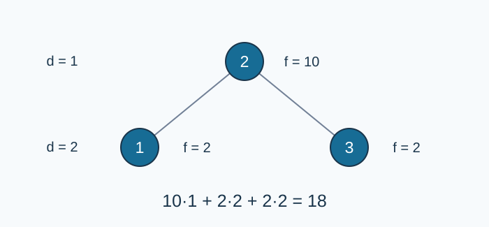

# 最优二叉检索树

- 参考时间限制：0.5 秒（参考环境：R30；仅供预估）
- 实际时间限制：标准程序在目标评测环境中处理最慢正式测试文件的基准时间乘以 2，再按 0.5 秒向上取整。
- 内存限制：128 MB

## 背景故事

检索系统保存一组按编号排序的条目。频繁访问的条目适合放在较浅的位置，但整棵树仍须满足二叉搜索树的顺序。请选择总代价最小的布局。

(本故事由GPT-6重写)

## 形式化问题描述

把编号 $1,\ldots,n$ 各使用一次，组成一棵二叉搜索树：每个结点左子树的编号都小于它，右子树的编号都大于它。根的深度为一，孩子的深度等于父亲深度加一。

编号 $i$ 的访问次数为 $f_i$ ，总代价为 $\sum_{i=1}^n f_i d_i$ ，其中 $d_i$ 是它的深度。求最小总代价，并输出所有最优树中字典序最小的先序遍历。

先序遍历依次访问根、左子树和右子树。字典序按整数比较，第一个不同位置的编号较小者更小；不是按编号的十进制字符串比较。访问次数已包含整次检索的需求，不额外累加祖先的访问次数。

## 输入格式

第一行一个整数 $n$ .第二行 $n$ 个整数 $f_1,\ldots,f_n$ .

## 输出格式

第一行输出最小总代价。第二行输出最优树中字典序最小的先序遍历，相邻编号以空格分隔。

## 样例 1

### 输入

```text
3
2 10 2
```

### 输出

```text
18
2 1 3
```

### 解释

以二号结点为根，总代价为 $10+2\cdot2+2\cdot2=18$ .



圆圈标明结点编号，旁边列出频次和深度。

## 样例 2

### 输入

```text
4
0 0 0 0
```

### 输出

```text
0
1 2 3 4
```

### 解释

所有树的代价都是零；从一号结点开始的全右链给出最小先序序列。

## 样例 3

### 输入

```text
1
1000000000
```

### 输出

```text
1000000000
1
```

### 解释

唯一结点的深度为一。

## 数据范围与保证

$1\le n\le500$ ；$0\le f_i\le10^9$ .所有输入均为整数；零次访问的条目也必须出现在树中。

数据规格由 Codex（GPT-6）补齐：确定上述规模、非负访问次数和零权值边界，并提供对应测试分组。

### 数据分组

| 分值比例 | 额外条件 |
| --- | --- |
| 20% | $n\le9$ |
| 30% | $n\le100$ |
| 50% | 无额外条件 |

[参考评测环境与测量](../../../docs/评测环境与性能.md)
